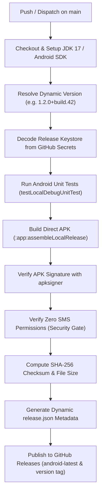

# Arth Android Release & Automation Architecture

This document specifies the automated CI/CD release pipeline, APK signing architecture, security invariants, and web distribution mechanism for the official native Arth Android application.

---

## 1. Distribution Architecture

Arth provides two parallel Android distribution tracks:

| Track | Variant / Flavor | Application ID | SMS Permissions | Distribution Channel |
|---|---|---|---|---|
| **Direct Web Download** | `localRelease` | `com.digitaldodo.arth.local` | **None** (Zero SMS permissions) | Arth Website (`/download` & `/api/android/download`) via GitHub Releases |
| **Play Store Release** | `playRelease` | `com.digitaldodo.arth` | `READ_SMS`, `RECEIVE_SMS` (Declared Financial Policy) | Google Play Console (Upcoming) |

### Why Two Flavors?
Direct APK installation on Android devices triggers Google Play Protect alerts if an APK requests sensitive device permissions like `READ_SMS` without Google Play policy review. By maintaining the `local` flavor for website distribution:
1. The app installs cleanly without Play Protect warnings or blocked installations.
2. Users enjoy full offline-first transaction tracking, biometric fingerprint app lock, and Supabase cloud synchronization.
3. Automated transaction detection from bank/UPI SMS is cleanly reserved for the reviewed Google Play Store distribution channel.

---

## 2. Automated Release Pipeline (`.github/workflows/android-release.yml`)

The automated workflow executes on GitHub Actions under `ubuntu-latest`:

### Triggers
1. **Push to `main`**: Any commit altering paths under `android/**` or `.github/workflows/android-release.yml`.
2. **Version Tags**: Pushing a tag matching `v*.*.*` (e.g., `git push origin v1.2.0`).
3. **Manual Dispatch (`workflow_dispatch`)**: Triggering manually from GitHub Actions UI with custom `version_name` and `version_code`.

### Execution Pipeline



### Safety & Integrity Controls
- **Never publish on failure**: If unit tests, lint checks, compilation, signature verification, or permission checks fail, the pipeline halts immediately. The live APK on the website is never replaced with a broken build.
- **Automated Permission Gate**: CI runs `aapt dump permissions Arth.apk` and checks for `READ_SMS`, `RECEIVE_SMS`, or `SEND_SMS`. If detected, the build aborts with an error.

---

## 3. Versioning Scheme

Arth employs dual human-readable and machine-incremental versioning:

- **Version Name (`versionName`)**: `${BASE_VERSION}+build.${BUILD_NUMBER}`  
  *Example*: `1.2.0+build.42`
- **Version Code (`versionCode`)**: `1000 + BUILD_NUMBER`  
  *Example*: `1042`

When triggered via GitHub Actions, `${BUILD_NUMBER}` defaults to `${{ github.run_number }}`. Local Gradle runs default to `1003` / `1.2.0+build.3` unless overridden via environment variables or `-PversionName` / `-PversionCode`.

---

## 4. Signing Keystore & GitHub Secrets Configuration

To enable official cryptographic signing in CI/CD, configure the following secrets in the GitHub repository (**Settings → Secrets and variables → Actions**):

| Secret Name | Description | Example / Format |
|---|---|---|
| `ANDROID_KEYSTORE_BASE64` | Base64-encoded release keystore binary | Output of `base64 -w 0 release.keystore` |
| `ANDROID_KEYSTORE_PASSWORD` | Master password for the keystore | Your strong password |
| `ANDROID_KEY_ALIAS` | Key alias name inside keystore | `arth` |
| `ANDROID_KEY_PASSWORD` | Key private password | Your strong key password |

*(Note: The workflow also checks `ANDROID_RELEASE_KEYSTORE_BASE64` for backwards compatibility).*

### Generating a New Production Keystore
If you need to generate a new production release keystore:

```bash
# Generate the keystore
keytool -genkey -v -keystore release.keystore -alias arth -keyalg RSA -keysize 2048 -validity 10000

# Base64 encode for GitHub Secrets (Linux/macOS)
base64 -w 0 release.keystore > keystore_base64.txt

# Base64 encode in Windows PowerShell
[Convert]::ToBase64String([IO.File]::ReadAllBytes("release.keystore")) | Out-File -Encoding ascii keystore_base64.txt
```

> **Security Rule**: Never commit `.keystore`, `.jks`, or passwords to the Git repository. The file `release.keystore` is explicitly gitignored.

---

## 5. Web Distribution Architecture

The web application exposes three coordinated touchpoints:

### 1. Dedicated Download Page (`/download`)
- URL: `https://arth-9h3f.vercel.app/download`
- Built with the Arth Ledger Minimal design system.
- Displays version badge, release date, exact APK file size, and minimum OS requirement (`Android 8.0+`).
- Displays the cryptographic **SHA-256 checksum** with a 1-click copy action.
- Provides step-by-step installation instructions for sideloading unknown apps on Android.
- Contains a clear transparency disclosure clarifying that direct APK downloads do not contain SMS permissions.

### 2. Perpetual Download Redirect Endpoint (`/api/android/download`)
- Responds with an **HTTP 302 Found** directing visitors straight to the latest release APK asset:
  `https://github.com/digitaldodo/Arth/releases/download/android-latest/Arth.apk`
- Provides an immutable, permanent download link suitable for QR codes, external links, and the web UI.

### 3. Dynamic Metadata API (`/api/android/release`)
- Polls the GitHub Releases API for `android-latest` asset information (file size, updated timestamps, download URLs).
- Implements a 5-minute HTTP cache (`Cache-Control: public, s-maxage=300, stale-while-revalidate=600`).
- Seamlessly falls back to local `public/android/release.json` if GitHub API is unreachable or rate-limited.

### 4. Website Navigation Integration
- **Header**: Added "Download App" button with download glyph in `UnauthenticatedHome.tsx` and `TransactionAppShell.tsx`.
- **Footer**: Added "Android App" link in the footer.
- **More Hub**: Added a dedicated "Native Android Application" card in the authenticated settings/more view.

---

## 6. Verification and Maintenance

### Verifying a Downloaded APK Locally
Users and developers can independently verify the authenticity and integrity of `Arth.apk`:

```bash
# Check SHA-256 (Linux / macOS)
sha256sum Arth.apk

# Check SHA-256 (Windows PowerShell)
Get-FileHash Arth.apk -Algorithm SHA256

# Verify cryptographic signature using Android SDK
apksigner verify --verbose Arth.apk

# Verify declared permissions (ensure no READ_SMS)
aapt dump permissions Arth.apk
```
