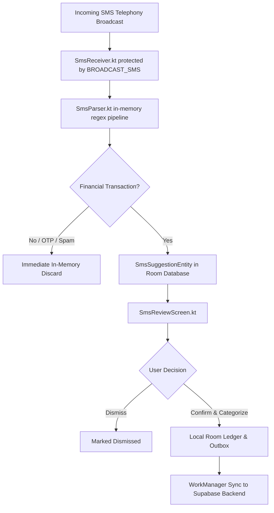

# Arth Native Android App — SMS Transaction Detection Architecture

Arth provides on-device financial transaction detection from incoming Indian banking, UPI, card, and wallet SMS alerts.

---

## 1. Core Principles & Privacy Guarantees

1. **100% On-Device Parsing**:
   Raw SMS message bodies never leave the user's physical Android device. No raw SMS text, phone numbers, or metadata are transmitted over network connections or logged to cloud servers.
2. **Prominent User Disclosure & Consent**:
   Before requesting SMS permissions in the Google Play build, Arth presents an explicit, high-contrast modal dialog explaining exactly why SMS access is required and confirming that only financial messages are processed.
3. **No Automatic Ledger Mutation**:
   Detected transactions are never directly written into the user's financial balance or ledger. Instead, they enter a local **Candidate Review Queue** (`SmsSuggestionEntity` in Room).
4. **Mandatory User Confirmation**:
   The user explicitly reviews each candidate in the UI:
   - Verify detected amount and transaction type (Debit / Credit / Transfer).
   - Select the target account (Online Bank / Cash).
   - Assign or confirm the category (e.g., Food, Travel, Utilities) and necessity (Need / Want / Investment).
   - Confirm or dismiss the candidate. Dismissed items are discarded.
5. **Immediate OTP & Promotional Discard**:
   One-Time Passwords (OTPs), verification codes, spam, and non-financial messages are discarded instantly in memory without saving to disk.

---

## 2. Technical Architecture



### Components:
- **`SmsReceiver.kt`**: BroadcastReceiver listening for `Telephony.Sms.Intents.SMS_RECEIVED_ACTION`.
  - Exported with `android:permission="android.permission.BROADCAST_SMS"` to ensure only the Android OS telephony framework can dispatch SMS events to this receiver.
  - Declared exclusively in `src/play/AndroidManifest.xml` (omitted from `src/local/AndroidManifest.xml`).
- **`SmsParser.kt`**: Specialized parser calibrated against Indian banking and payment formats:
  - Banks: HDFC, SBI, ICICI, Axis, Kotak, PNB, Bank of Baroda, IndusInd, Yes Bank, IDFC First.
  - Payment rails: UPI (GPay, PhonePe, Paytm, BHIM, Cred, Amazon Pay), NEFT, RTGS, IMPS, ATM Cash Withdrawals.
  - Amounts: Integer paise calculations (`Long`) to eliminate floating-point rounding errors.
  - Detection of debit vs. credit, merchant attribution (`to/at <merchant>`), and reference numbers (UTR, Txn ID, RRN).
- **`SmsSuggestionDao.kt`**: Reactive Room DAO providing Flow streams of pending candidates for the UI.
- **`SmsReviewScreen.kt`**: Material 3 Compose screen displaying detected transactions with high-contrast cards, merchant tags, date formatting, and category dropdowns.

---

## 3. Product Flavor Support (`BuildConfig.SMS_DETECTION_SUPPORTED`)

The feature dynamically adapts based on the active build variant:

```kotlin
val isSmsSupported = BuildConfig.SMS_DETECTION_SUPPORTED
```

- **In `local` builds (`isSmsSupported == false`)**:
  - The Settings item for SMS Detection displays: `"Disabled in local build • Available in Play release"`.
  - Tapping the item shows a non-intrusive dialog explaining that local sideload builds exclude sensitive permissions to avoid Play Protect friction.
  - No permission dialogs or system permission requests are ever triggered.
- **In `play` builds (`isSmsSupported == true`)**:
  - Tapping the item triggers the `SmsDisclosureDialog`.
  - Upon user agreement, Android's permission launcher requests `RECEIVE_SMS`, `READ_SMS`, and `POST_NOTIFICATIONS`.
  - Upon grant, the broadcast receiver processes incoming messages and populates the review queue.
