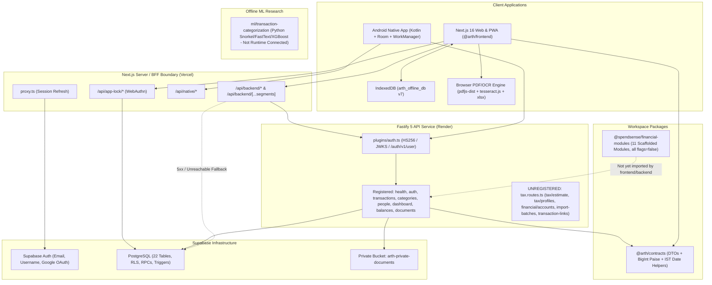
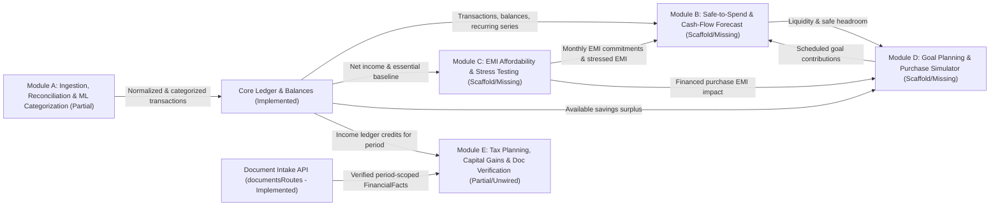
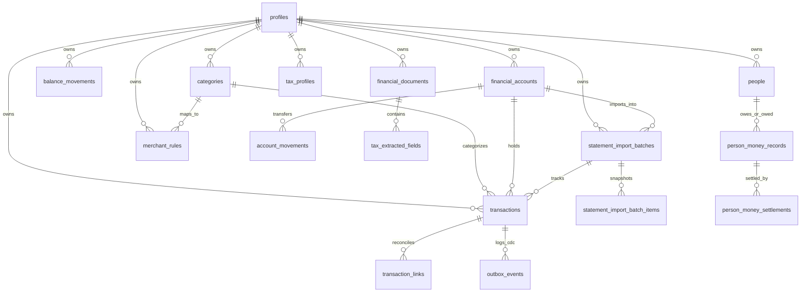

# SpendSense — Architecture & Dependency Map

**Audit Date:** 2026-11-25  
**Source Baseline:** `main` @ `518d3c9`

---

## 1. System Architecture Overview

SpendSense operates as a **4-tier polyglot monorepo**:
1. **Clients**: Next.js 16 Web/PWA (`frontend/`), Native Android Kotlin/Compose app (`android/`).
2. **BFF Proxy Layer**: Next.js Route Handlers (`/api/backend/*`, `/api/native/*`, `/api/app-lock/*`) holding Supabase `HttpOnly` session cookies and forwarding Bearer JWTs.
3. **Domain API Service**: Fastify 5 (`backend/`) enforcing JWT authentication (`jose`), request validation, and user-scoped PostgREST/RPC calls.
4. **Authoritative Store**: Supabase PostgreSQL (`supabase/migrations/0001`–`0039`) with Row-Level Security (`auth.uid() = user_id`), integer-paise (`BIGINT`) accounting, private document storage (`arth-private-documents`), and triggers.

---

## 2. Frontend / Backend / Database Boundaries

| Boundary | Owned Responsibilities | Current Leakage / Boundary Violations |
|---|---|---|
| **Frontend (`frontend/src/`)** | Rendering, form UX, local IndexedDB offline cache (`syncEngine`), local statement & tax PDF/OCR parsing (privacy-by-design: raw files never leave browser), category rule suggestions (`localStorage`). | BFF route handlers (`api/backend/transactions/route.ts`, `[...segments]/route.ts`, `dashboard/route.ts`) query/mutate Supabase directly as fallback when Fastify is down/5xx, duplicating business/query logic. |
| **Backend (`backend/src/`)** | Stateless JWT validation, strict input validation, tax calculations (`tax-engine.ts`), RPC invocation, PostgreSQL error translation. | `tax.routes.ts` is orphaned (not registered in `app.ts`) and duplicates `documentsRoutes`; `merchant_rules` has no backend service/routes despite existing in PostgreSQL. |
| **Packages (`packages/`)** | `@arth/contracts`: shared DTOs + money formatting. `@spendsense/financial-modules`: typed module boundaries + feature flags. | `@spendsense/financial-modules` is completely isolated (0 imports from `frontend/` or `backend/`); `contracts` does not yet export document, tax, EMI, goal, or Safe-to-Spend DTOs. |
| **Database (`supabase/`)** | Authoritative persistence, integer-paise checks, composite ownership FKs, RLS policies, atomic RPCs (`fn_dashboard_summary`, `fn_account_balances`, `fn_record_person_settlement`, `undo_statement_import_batch`, `confirm_transaction_reconciliation`). | `goals`, `loan_obligations`, and `cash_flow_commitments` tables do not exist yet; `outbox_events` still accumulates rows via `trg_transactions_outbox` even though Sheets drain is retired. |

---

## 3. Module Dependency Graph (Target Academic Architecture vs. Current)

---

## 4. API Communication & Route Wiring Map

### 4.1 Currently Live Endpoints (`backend/src/app.ts` + `frontend/src/app/api/`)

| Client Call / BFF Proxy | Fastify Endpoint | Status |
|---|---|---|
| `GET /api/backend/auth/me` | `GET /api/v1/auth/me` | Live |
| `GET/POST /api/backend/transactions` | `GET/POST /api/v1/transactions` | Live (+ Supabase direct fallback in BFF) |
| `PATCH/DELETE /api/backend/transactions/[id]` | `PATCH/DELETE /api/v1/transactions/:id` | Live |
| `POST /api/backend/transactions/[id]/restore` | `POST /api/v1/transactions/:id/restore` | Live |
| `GET/POST /api/backend/categories`, `PATCH /[id]`, `PATCH /[id]/archive` | `/api/v1/categories*` | Live |
| `GET /api/backend/dashboard` | `GET /api/v1/dashboard/summary` | Live (+ necessity fallback in BFF) |
| `GET /api/backend/balances*` | `/api/v1/balances*` | Live |
| `GET/POST /api/backend/people*` | `/api/v1/people*` | Live |
| `GET/POST/DELETE /api/backend/financial/documents*` | `/api/v1/financial/documents*` (`documentsRoutes`) | Live |

### 4.2 Broken / Unwired Endpoints (`[...segments]/route.ts` vs `tax.routes.ts`)

| Whitelisted in BFF `[...segments]/route.ts` | Defined in `tax.routes.ts` | Actual Runtime Behavior |
|---|---|---|
| `POST /api/backend/tax/estimate` | `POST /api/v1/tax/estimate` | **404 on Fastify** (`taxRoutes` not registered in `app.ts`); no frontend caller |
| `GET/PUT /api/backend/tax/profiles` | `GET/PUT /api/v1/tax/profiles` | **404 on Fastify**; no frontend caller |
| `GET/POST /api/backend/financial/accounts` | `GET/POST /api/v1/financial/accounts` | **404 on Fastify** (silently ignored in `QuickAddModal.tsx`) |
| `GET/POST /api/backend/financial/transaction-links*` | `/api/v1/financial/transaction-links*` | **404 on Fastify** (`CrossAccountReconciliation.tsx` fails unless fallback added) |
| `GET/POST /api/backend/financial/import-batches*` | `/api/v1/financial/import-batches*` | **404 on Fastify**, rescued only by direct Supabase fallback in `[...segments]/route.ts` |

---

## 5. Database Entity-Relationship Diagram

---

## 6. ML, Document-Processing & Synchronization Flows

### 6.1 ML Categorization Data Flow
- **Offline Research (`ml/transaction-categorization/`)**:
  - Input: `benchmark_dataset.csv` (60 synthetic rows, 48 train / 12 test temporal split).
  - Weak Supervision: 7 labeling functions (`LABELING_FUNCTIONS` in `pipeline.py`) + optional `SnorkelLabelModel` (`weak_supervision.py`).
  - Research Models (`evaluate.py`, `anchored_hybrid.py`, `fasttext_adapter.py`): `weak_label_rules` (ran), `snorkel_label_model` (not run), `tfidf_xgboost` (not run), `sentence_transformer_xgboost` (not run), `snorkel_anchored_fasttext_xgboost` (not run), `anchored_fasttext` (not run).
- **Runtime (Web & Android)**:
  - Web uses deterministic TS rules (`upi-parser.ts` → `user-merchant-rules.ts` in `localStorage` → `layered-categorization.ts` → `pipeline.ts` `suggestCategory`).
  - Android duplicates a parallel Kotlin implementation (`IndianCategorizationEngine.kt` + `SharedPreferences`).
  - **Gap**: No shared model artifact, no backend inference endpoint, and no DB sync for `public.merchant_rules`.

### 6.2 Document-Processing Flow (Privacy-First Local Pipeline)
1. User picks PDF/CSV/XLSX/XLS in `DocumentsTaxCentre.tsx` (max 30 MB).
2. Browser extracts text via `pdfjs-dist` (with in-memory password unlock) or `xlsx`; if scanned PDF (`< 40` non-whitespace chars), user may opt into local `tesseract.js` (`eng+hin`, max 25 pages).
3. `classifyTaxDocument()` suggests document type, tax period (`AY`/`TY`), and issuer; `detectTaxFieldCandidates()` regex-matches rupee amounts with page/location provenance.
4. User reviews and confirms save: browser computes SHA-256 and calls `POST /api/backend/financial/documents` (`retention_mode: 'metadata_only'`) and `POST .../fields` (`amount_paise` integer string). **Original file bytes are discarded from memory.**
5. **Missing Handoff**: Verified fields are stored in `tax_extracted_fields`, but no UI reconciles them across documents or sends them to `/api/v1/tax/estimate`.

### 6.3 Synchronization Flow
- **Local-First Queue (`syncEngine` + `offline-db.ts`)**: Mutations write atomically to IndexedDB (`transactions` + `pending_mutations` + `balances`), then drain sequentially to `/api/backend/transactions` and `/api/backend/balances*` on reconnect, window focus, or 60s interval.
- **PostgreSQL Outbox (`outbox_events`)**: `trg_transactions_outbox` records every transaction mutation; `sheets-worker.ts` `drainUserOutbox()` is now an intentional no-op after Google Sheets sync retirement.

---

## 7. Integration Risks & Shared-File Ownership Recommendations

### Highest-Risk Integration Points
1. **Route Collision & 404s (`backend/src/app.ts` & `tax.routes.ts`)**: Must be resolved before Module A (import batches/accounts/links) or Module E (tax estimate/profiles) can test end-to-end against Fastify.
2. **Duplicate Detection & OCR State (`statement-parser.ts` / `historical-reconciliation.ts`)**: Currently breaking 5 frontend tests; must be stabilized before Module A adds ML/API rule sync.
3. **Contract Coupling Among B, C, and D**: Safe-to-Spend (B), EMI Affordability (C), and Goal Purchase Simulator (D) share concepts of *net monthly income*, *essential spend*, *existing EMIs*, and *scheduled goal savings*. Without locked DTO contracts in `@arth/contracts` / `@spendsense/financial-modules/shared/contracts.ts`, teams will duplicate income/expense aggregation queries or double-count EMIs and goal transfers.
4. **Shared UI Shell (`TransactionAppShell.tsx`) & Migration Numbering (`supabase/migrations/`)**: All 5 modules eventually plug into `TransactionAppShell.tsx` and 4 modules add tables. Uncoordinated edits will cause merge conflicts or migration number collisions.

### Single-Maintainer Shared-File Policy
Assign **one Integration Lead (Ansh Gupta)** with PR-review gates for:
- `backend/src/app.ts` (plugin registration only)
- `packages/contracts/src/*` & `packages/financial-modules/src/shared/*`
- `frontend/src/features/transactions/TransactionAppShell.tsx` (1-line dynamic view registration per module)
- `frontend/src/lib/api-client/index.ts` (or prefer per-module API client modules `lib/api-client/<module>.ts` + dedicated BFF folders `/api/backend/<module>/*` so zero shared files are touched during parallel sprints)
- `supabase/migrations/` (strict pre-assigned migration number slots: `0040`–`0043`)
