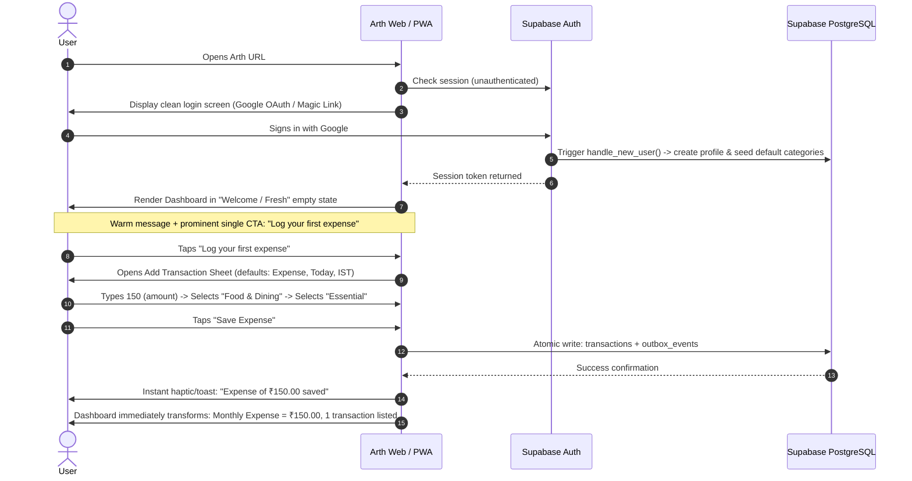
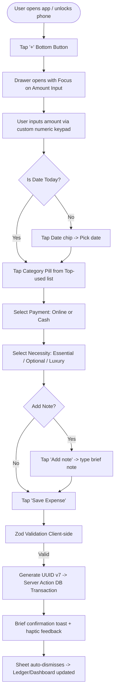
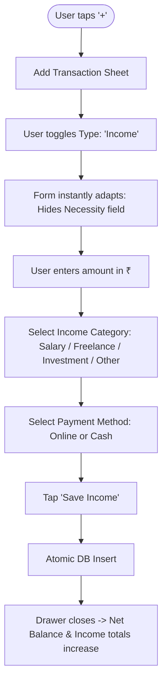
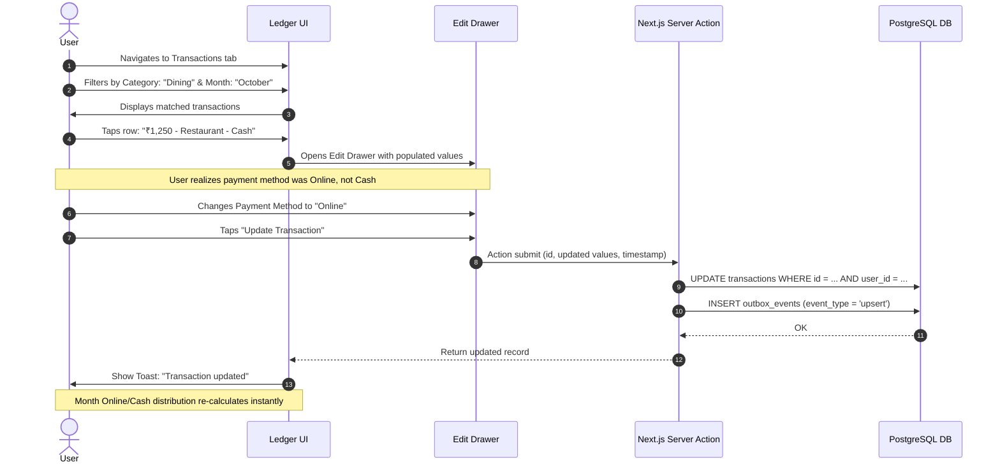
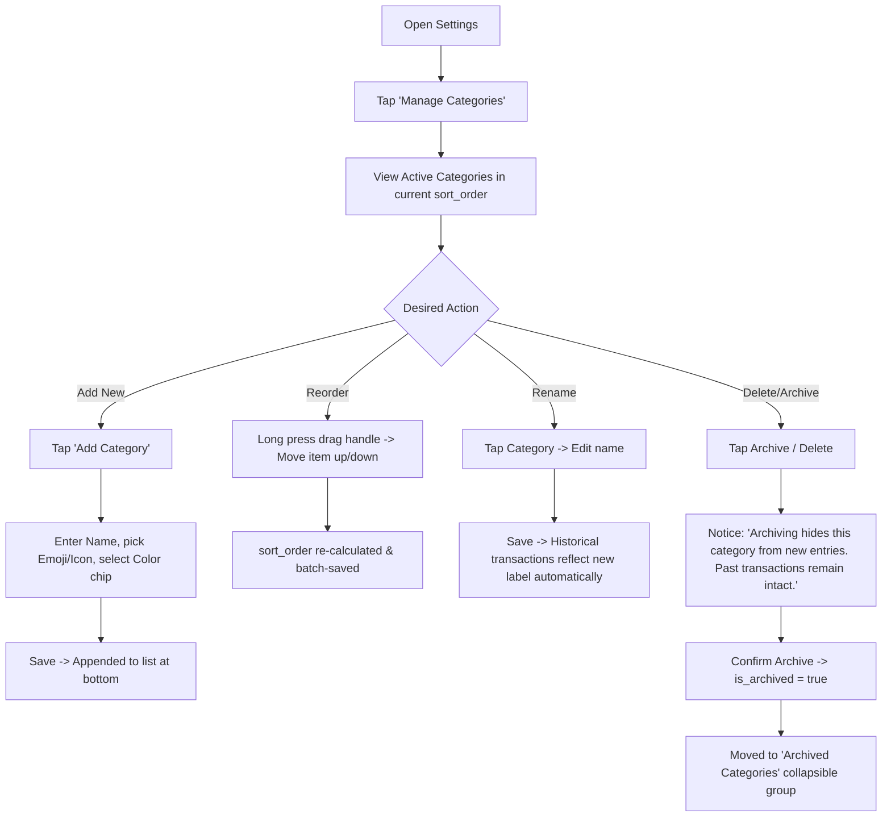
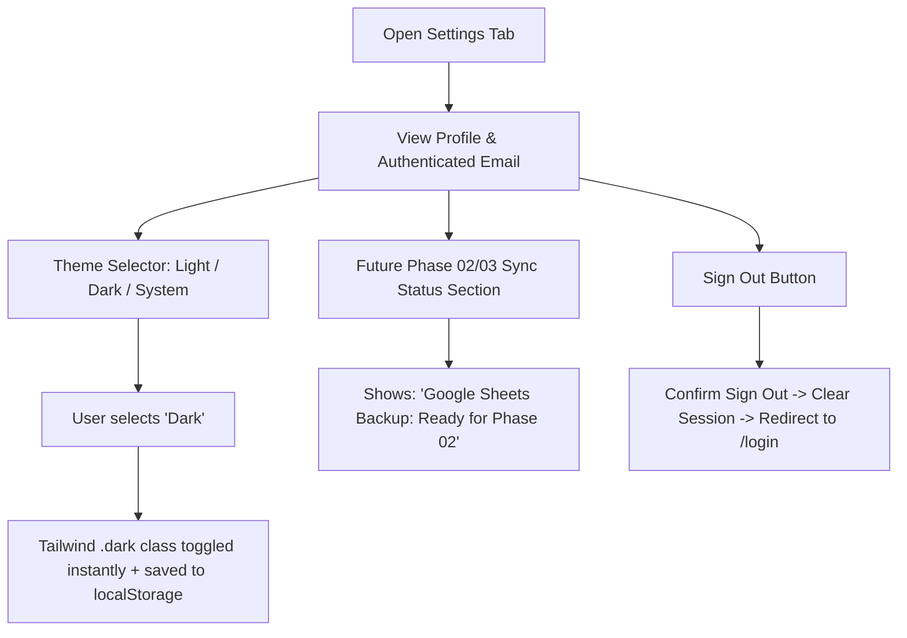
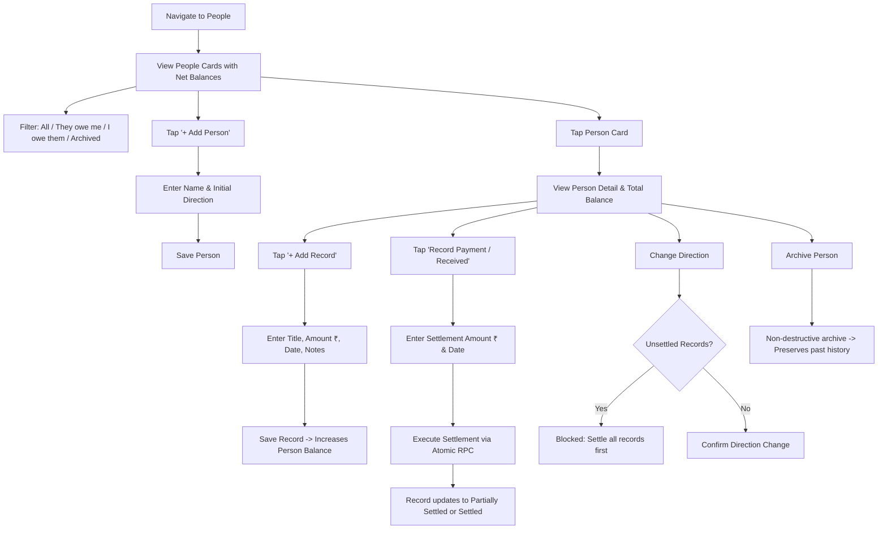

# Arth — UX Architecture, Information Architecture & User Flows

> **Document Version**: 1.0 — Phase 01A  
> **Status**: Completed / Ready for Owner Review  
> **Date**: 2026-10-25  
> **Target Audience**: Product Owner, Frontend Engineers, UI Designers, AI Agents  

---

## 1. Product UX Principles

Arth is designed around disciplined, deliberate manual finance tracking. Unlike automated aggregation apps that encourage passive detachment, Arth views manual recording as an intentional habit. The user experience must actively support, streamline, and respect this daily habit.

1. **Frictionless Entry Above All Else**  
   Entering a transaction must take under 5 seconds on a mobile device with one hand. Any barrier, superfluous tap, or lagging transition degrades compliance.

2. **Ruthless Signal-to-Noise Ratio (Minimalism)**  
   Every screen presents only what is necessary to accomplish the immediate goal. Dense dashboards with decorative charts, vanity gauges, and cluttered metrics cause cognitive fatigue and obscure financial reality.

3. **Progressive Disclosure as Core Mechanics**  
   Primary views expose essential facts and primary triggers (Level 1). Secondary breakdowns and filters are revealed only on explicit interaction (Level 2). Deep maintenance and audit logs remain safely tucked into dedicated sub-views (Level 3).

4. **Deterministic & Transparent Financial Truth**  
   Money is stored in integer paise and displayed in formatted INR (`₹`). Calculations are exact. System states (saved locally, saved to PostgreSQL database, or queued for Google Sheets in future phases) must be transparently communicated without causing alarm.

5. **Ergonomic One-Handed Mobile Operation**  
   Interactive elements, primary actions, and confirmation buttons reside primarily in the bottom 45% of the mobile viewport (the natural thumb reach zone).

6. **Forgiving by Design (Error Prevention & Recovery)**  
   Forms prevent impossible combinations (e.g. income with necessity rating), offer instantaneous validation, protect against accidental dismissal of unsaved drafts, and provide reversible actions (undoable soft-deletes) rather than aggressive blocking modals.

7. **Aesthetic Restraint & Theme Dualism**  
   The UI will support both pristine Light and deep Dark themes. Color is never the sole carrier of meaning; type labels, icons, and structured layout accompany every status indicator.

---

## 2. Prioritized User Goals (Job Stories)

The following jobs represent the complete operational surface of Arth for the initial releases. They are ranked by **Frequency**, **Importance**, and **Expected Ease of Completion**.

| Priority | Job Story | Frequency | Importance | Target Completion Time / Ease |
|---|---|---|---|---|
| **1. Record Expense** | *When I spend money on anything, I want to log the amount, category, payment method, and necessity immediately so my records stay accurate.* | Multiple times daily | **Critical** | < 5 seconds; 3–4 taps + keypad |
| **2. Review Spending (Today & Month)** | *When I open the app, I want to see how much I spent today and so far this month, so I know where I stand financially.* | 1–3 times daily | **Critical** | < 1 second; zero-tap instant glance |
| **3. Record Income** | *When I receive salary, payment, or interest, I want to record it with source category and payment mode so my net balance is true.* | 1–4 times monthly | **High** | < 6 seconds; fast, bypasses expense fields |
| **4. Understand Category Breakdown** | *When reviewing my monthly spending, I want to see which categories took the largest share so I can modulate my behavior.* | 2–4 times monthly | **High** | 1 tap to reveal; clear ranked list/split |
| **5. Inspect Necessity Ratio** | *When evaluating financial discipline, I want to see how much went to Essentials vs Optional vs Luxury.* | Weekly / Monthly | **High** | 1 tap to toggle metric; clear proportion |
| **6. Correct / Edit an Existing Entry** | *When I notice an error in a note, category, or amount, I want to find that transaction and fix it without corrupting totals.* | Occasional (weekly) | **Medium** | < 10 seconds; search/filter + edit modal |
| **7. Reorganize Categories** | *When my spending habits evolve, I want to add, rename, reorder, or archive categories without breaking past data.* | Rare (monthly/quarterly) | **Medium** | Drag-to-order, inline edit; no history break |
| **8. Adjust Appearance & Settings** | *When using the app at night or on a new device, I want to toggle dark/light mode or inspect account details.* | Infrequent | **Low** | 2 taps; immediate visual change |
| **9. Verify Save & Sync Integrity (Future)** | *When recording on poor network, I want reassurance that my data is safe locally and will sync cleanly to Supabase/Sheets.* | Continuous / Ambient | **High (System)** | Ambient badge; zero user effort needed |

---

## 3. Information Architecture and Navigation Model

### 3.1 Evaluation of Top-Level Destinations

The five candidate destinations were evaluated for their operational frequency and access requirements:

| Destination | Function | User Access Pattern | Architectural Placement |
|---|---|---|---|
| **Dashboard** | Pulse check: Current month totals (Income, Expense, Net), today's total, necessity breakdown, 5 most recent transactions. | Primary entry point (default screen). Visited multiple times daily. | **Persistent Navigation (Tab 1)** |
| **Transactions** | Complete chronological ledger: Infinite/paginated scroll, date filter, category filter, necessity filter, keyword search, editing, deletion. | High-frequency lookup and auditing. Visited daily or every few days. | **Persistent Navigation (Tab 2)** |
| **Add Transaction** | Modal creation workflow for Expense and Income. | Highest-frequency user action. Triggered from anywhere at any moment. | **Persistent Center Action (Hero CTA)** |
| **Categories** | Category taxonomy manager: Add, reorder, rename, archive, color/icon assignment. | Administrative/maintenance. Visited infrequently (weeks or months apart). | **Secondary Navigation (Accessible via Settings or Sub-nav)** |
| **Settings** | User profile, theme preference (system/light/dark), data export triggers (Phase 02), sync status diagnostics (Phase 02/03), logout. | Administrative/configuration. Visited rarely. | **Persistent Navigation (Tab 3 or Profile Avatar)** |

### 3.2 Recommended Navigation Structure

#### Mobile Layout (< 768px): 5-Item Bottom Navigation Bar with Central "Quick Add" Action

The mobile navigation is organized into **4 primary domain tabs + 1 central Hero Action button**:

```
┌────────────────────────────────────────────────────────┐
│                        VIEWPORT                        │
│                                                        │
│                    (Active Screen)                     │
│                                                        │
├────────────────────────────────────────────────────────┤
│  [Home]    [Ledger]     [ ( + ) ]    [People]   [More] │
│   🏠          📊        Quick Add       👥        ☰    │
└────────────────────────────────────────────────────────┘
```

**Mobile Navigation Destinations:**  
1. **Home / Dashboard** (Icon + label): Financial pulse check and recent records.
2. **Ledger / History** (Icon + label): Chronological transaction log, filters, and cash flow analysis.
3. **Add (+)** (Prominent high-contrast central button): Opens Transaction Quick Add drawer immediately without unloading the underlying view.
4. **People** (Icon + label): People & Money Tracker with direction-filtered debtor/creditor balances.
5. **More** (Icon + label): Secondary operational hub providing direct access to Category Management, Appearance (Theme toggle), Account Profile, and Sign Out.

*Why this 5-item layout works best:*
- Direct thumb-zone access to high-velocity daily flows (Ledger, Quick Add, People).
- Preserves clean access to maintenance utilities (Categories and Settings) via the "More" screen without cluttering primary tabs.
- Tapping `(+)` opens the Transaction Entry Drawer over the current context without unloading state.

#### Desktop & Tablet Layout (≥ 768px): Header Tabs + Action Controls

On desktop and tablet screens:
- **Left Header**: App Logo ("Arth") + Primary Navigation Tabs: **Ledger | People | Categories**.
- **Right Header**: Direct "+ Add Transaction" button, Theme Toggle, User Profile badge, and Sign Out action.

### 3.3 Returning from Secondary Tasks Without Context Loss

- **Transaction Entry** opens in an ergonomic **Bottom Sheet / Drawer** on mobile, and a **Centered Dialog Modal** on desktop. Closing or cancelling restores the user exactly to their prior scroll position and filter state.
- **Transaction Editing** similarly opens the record inside an edit sheet; saving updates the in-memory cache and table row without triggering a jarring full-page refresh.
- **Unsaved Drafts**: If a user enters an amount and taps outside the sheet, an inline confirmation prevents accidental dismiss: *"Discard unsaved transaction? [Keep Editing] [Discard]"*.

---

## 4. Screen Hierarchy & Transitions

```mermaid
flowchart TD
    Auth[Supabase Auth / Login] -->|Authenticated| Dash[Dashboard - /dashboard]
    
    Dash -->|Tap (+) or Press 'N'| QuickAdd[Add Transaction Sheet / Modal]
    Dash -->|Tap 'View All' or Tab| Ledger[Transaction History - /transactions]
    Dash -->|Tap Category Summary| CatDetail[Filtered History by Category]
    Dash -->|Tap Necessity Bar| NecDetail[Filtered History by Necessity]
    Dash -->|Tap Profile/Settings| Settings[Settings - /settings]
    
    Ledger -->|Tap Row| EditTx[Edit Transaction Sheet / Modal]
    Ledger -->|Tap Filter Action| FilterSheet[Filter & Search Drawer]
    
    Settings -->|Manage Taxonomy| CatMgr[Category Manager - /categories]
    Settings -->|Theme / Export| SettingsDetails[Preferences & Data]
    
    CatMgr -->|Add / Edit| CatModal[Category Form Drawer]

    QuickAdd -->|Save Success| Dash
    QuickAdd -->|Save Success from Ledger| Ledger
    EditTx -->|Save Success| Ledger
```

### Transition & Context Preservation Rules
1. **Modal Sheets over Full Pages**: Transaction creation and editing must never be full-page route transitions on mobile. Using an overlay sheet preserves the scroll position, active tab, and query parameters of the calling screen.
2. **Deep-linking & URL State**: Filter state on the Transaction History screen is mirrored in URL query params (`/transactions?category=food&month=2026-10&sort=desc`). Tapping back from an edited transaction retains the exact filter state.
3. **Esc Key & Backdrop Click**: On desktop, `Escape` key dismisses modals (with dirty-state guard if fields have values).

---

## 5. Core User Journeys & Flow Diagrams

### Flow A: First Use (Zero-Friction Onboarding)

*Objective*: Go from first login to logged transaction and visual dashboard in under 30 seconds without an intrusive wizard.



**Step-by-Step Experience**:
1. **Welcome Screen**: Clean, distraction-free authentication.
2. **First Dashboard View**: A polite, encouraging banner: *"Welcome to Arth. Your financial slate is clean."* A single high-visibility card: `[ + Record your first transaction ]`. Default categories (Food, Housing, Transport, etc.) are already seeded automatically in the background.
3. **First Entry**: User enters an amount (e.g. ₹150 for lunch), taps "Food & Dining", taps "Essential", and hits `Save`.
4. **Immediate Payoff**: The dashboard populates instantly with real numbers. The empty state disappears cleanly.

---

### Flow B: Quick Expense Entry (The 5-Second Path)

*Objective*: The most critical workflow. Record a day-to-day expense with minimal cognitive burden.



**Key Interaction Details**:
- **Default State**: Form defaults to **Type = Expense**, **Date = Today (Asia/Kolkata)**, and **Payment Method = Online** (configurable default; Online is 80%+ of modern Indian urban transactions).
- **Amount Entry**: Mobile automatically invokes `inputMode="decimal"` with large, readable digits.
- **Category Selection**: The top 6 most frequently used categories are shown as direct tap chips; an "All Categories" popover reveals the rest.
- **Necessity Selector**: Segmented control with 3 distinct options: `[ Essential | Optional | Luxury ]`.
- **Note**: Collapsed behind a subtle `+ Note` text link (Progressive Disclosure Level 2) so it never occupies vertical space unless desired.
- **Completion**: Save button shows loading spinner for <200ms, triggers light success haptic (on PWA), dismisses drawer, and updates local state optimistically.

---

### Flow C: Income Entry

*Objective*: Record income without being forced to answer expense-specific questions.



**Key Interaction Details**:
- Toggle switch at the very top: `[ Expense | Income ]`.
- When switching to **Income**:
  - The **Necessity selector disappears immediately** (not just disabled, completely removed from the layout to avoid visual clutter).
  - Category list switches to income-relevant categories (`Salary`, `Freelance`, `Dividends / Interest`, `Gift`, `Other Income`).
  - Accent indicators subtly shift to represent inflow rather than outflow.

---

### Flow D: Correct an Existing Transaction

*Objective*: Search or filter history, find an erroneous entry, fix it, and ensure aggregates refresh cleanly.



**Guardrails**:
- **Unsaved Edits**: If the user edits the amount and taps "Cancel" or backdrop, a confirmation appears: *"Discard changes to this transaction?"*.
- **Delete Option**: A destructive "Delete Transaction" action is available at the bottom of the Edit sheet. Tapping it requires a two-step confirmation (inline "Tap again to confirm delete") and triggers a reversible soft-delete with an *"Undo (5s)"* snackbar.

---

### Flow E: Review Spending (Dashboard Inspection)

*Objective*: Understand monthly financial health in 3 seconds; drill into details only on demand.

```mermaid
flowchart TD
    Open[Open Dashboard] --> GlancSummary[Level 1: View Top Metrics: Income, Expense, Net Savings]
    GlancSummary --> CheckToday[View 'Spent Today: ₹X']
    CheckToday --> Decision{Want to see category breakdown?}
    
    Decision -- No --> Done([Done with quick check])
    Decision -- Yes --> TapCatTab[Level 2: Tap 'Category Breakdown' pill]
    TapCatTab --> RevealCat[Ranked bar list: Food 42%, Rent 30%, Transport 12%]
    
    RevealCat --> Decision2{Want to inspect Luxury vs Essential?}
    Decision2 -- Yes --> TapNecTab[Tap 'Necessity Split' pill]
    TapNecTab --> RevealNec[Proportion bar: Essential 68%, Optional 22%, Luxury 10%]
    
    RevealNec --> Drilldown[Tap 'Luxury (₹4,200)' segment]
    Drilldown --> NavLedger[Level 3: Deep-link to Ledger pre-filtered by 'Luxury']
```

---

### Flow F: Manage Categories

*Objective*: Maintain personal taxonomy without breaking historical records.



---

### Flow G: Change Settings & Preferences

*Objective*: Switch theme or view sync diagnostics cleanly.



---

### Flow H: Track Money with People (Phase 01K)

*Objective*: Record loans and debts associated with people, record partial or full repayments, and track net balances per person.



---

## 6. Progressive-Disclosure Matrix

To maintain extreme clarity, every screen adheres to this strict 3-level disclosure architecture:

| Screen | Level 1: Immediately Visible (Zero-Tap) | Level 2: Revealed on Interaction (1-Tap Contextual) | Level 3: Advanced / Infrequent (Deep Dive / Sub-view) |
|---|---|---|---|
| **Dashboard** (`/dashboard`) | • Current Month Net Savings<br>• Month Total Income & Expense<br>• Today's Total Expense<br>• 5 most recent transactions with type, amount, category<br>• Hero (+) Button | • Category spending breakdown (ranked progress bars)<br>• Necessity ratio breakdown (Essential / Optional / Luxury toggle)<br>• Quick date-range selector (This Month / Last Month) | • "View All Transactions" (navigates to Ledger)<br>• Category-specific transaction drilldowns<br>• Full monthly export preview |
| **Transaction Entry** (Drawer / Sheet) | • Type Switcher (`Expense` / `Income`)<br>• Amount input field with large autofocus display<br>• Today's date chip (IST)<br>• Top 6 most frequent category chips<br>• Payment Method segmented control (`Online` / `Cash`)<br>• Necessity toggle (`Essential` / `Optional` / `Luxury` - Expense only)<br>• Big primary "Save" button | • Full category grid/search popover (if not in top 6)<br>• Date picker modal (to select past date)<br>• "+ Add Note" expandable text input | • Future Offline queue badge<br>• Advanced metadata (exact timestamp) |
| **Transactions Ledger** (`/transactions`) | • Chronological transaction feed grouped by date<br>• Search bar (keyword on note/category)<br>• Clear total matching count & sum<br>• Row displays: Amount, Category icon/name, Payment method badge, Necessity pill | • Filter Sheet: Filter by Date Range, Type, Category, Payment Method, Necessity<br>• Active filter chips with (x) clear buttons<br>• Row tap: Opens Edit Drawer | • Batch operations (future)<br>• Detailed audit view (created_at, UUID v7, raw paise value)<br>• Reversible soft-delete action |
| **People Tracker** (`/people`) | • Aggregate list of people with active balances<br>• Direction status badge & dual-encoded color<br>• Search filter & direction tabs (`All`, `They owe me`, `I owe them`)<br>• "+ Add Person" CTA | • Person Detail view with total outstanding balance banner<br>• Filter records by status (`All`, `Outstanding`, `Settled`)<br>• Named record cards with settlement history<br>• "+ Add Record" button | • "Record Payment / Received" settlement modal<br>• Rename Person modal<br>• Direction change confirmation (gated by settlement)<br>• Non-destructive Archive confirmation & restore |
| **Category Manager** (`/categories`) | • List of active categories with Icon, Name, and Drag handle<br>• Category count badge<br>• Floating "+ Add Category" button | • Inline edit name & icon selector sheet<br>• Archive button with impact explanation<br>• Color badge picker | • "Archived Categories" accordion (unarchive or inspect)<br>• Merge category utility (future) |
| **Settings / More** (`/settings`) | • Account Info (Display Name, Email, Auth Provider)<br>• Theme Switcher (`Light` / `Dark` / `System`)<br>• App Version & Timezone (`Asia/Kolkata`)<br>• Navigation link to Category Manager<br>• Sign Out button | • Future Sync Status Card (Supabase sync time, Sheets outbox queue counter)<br>• Manual Sync "Check Now" button (Phase 02)<br>• CSV / JSON Data Export buttons (Phase 02) | • Raw diagnostics log (for troubleshooting sync outbox)<br>• Account deletion / Reset data request |

---

## 7. Usability, Visual Hierarchy & Accessibility Principles

### 7.1 Usability & Interaction Design
- **Instant System Feedback**: Every button interaction provides visual feedback within 100ms. Save actions show an integrated spinner inside the button, not a jarring whole-screen overlay.
- **Error Prevention Over Error Display**:
  - The amount input forbids invalid characters (only digits and a single decimal point).
  - The "Save" action is disabled until the amount is greater than 0 and a category is chosen.
  - Expense necessity cannot be forgotten because it defaults to `Essential` with high-visibility alternative choices (`Optional`, `Luxury`).
  - Income forms physically omit necessity fields to eliminate invalid combinations.
- **Recognition Over Recall**: Categories feature distinct visual symbols/emojis and consistent color chips so users spot their target in milliseconds without reading every word.
- **Reversible Actions**: Deleting a transaction uses a non-destructive soft-delete with a 5-second "Undo" snackbar. The record is marked `deleted_at = now()`, immediately removed from view and totals, but recoverable before purge.

### 7.2 Visual Hierarchy & Cognitive Load
- **One Primary Action per View**:
  - Dashboard: Primary action is to understand spending; secondary is (+) Add.
  - Transaction Entry: Primary action is `Save Expense` (prominent bottom button).
  - Ledger: Primary action is browsing/searching records.
- **No Reliance on Color Alone**:
  - Income vs Expense: Income uses a `+` symbol prefix and an upward direction arrow icon `↑` alongside an emerald color tone; Expense uses a `−` prefix and downward arrow icon `↓` alongside a rose/neutral tone.
  - Necessity: `Essential` displays a solid shield icon; `Optional` displays a balance circle icon; `Luxury` displays a star/gem icon.
- **Elimination of Chart Clutter**:
  - No confusing 3D charts, nested spider charts, or multi-axis graphs.
  - Visual summaries use clean proportional horizontal bar charts with explicit percentage and currency labels.

### 7.3 Mobile-First Ergonomics
- **Touch Targets**: All interactive elements (chips, toggles, buttons, list rows) maintain a minimum target area of **44 × 44 CSS pixels**.
- **Thumb Zone Optimization**: Primary action buttons and form submit CTAs are pinned to the bottom of the viewport above the mobile browser bar.
- **Virtual Keypad Management**:
  - Amount input uses `<input type="text" inputMode="decimal" pattern="[0-9]*" />` ensuring mobile devices automatically open the large numeric keypad rather than the full alphanumeric keyboard.
  - Tapping outside form inputs dismisses the virtual keyboard without jumping the screen.
- **Zero Horizontal Scrolling**: Tables on desktop transform into card-style transaction rows on mobile with fluid flex wrapping.

### 7.4 Accessibility (WCAG 2.2 AA Target)
- **Contrast Ratios**: All text and meaningful UI boundaries maintain at least 4.5:1 contrast against their backgrounds in both Light and Dark themes (3:1 for large headers).
- **Keyboard Navigation & Focus Management**:
  - Opening a sheet or modal traps focus within that container.
  - First focused element is the Amount input.
  - Pressing `Tab` moves through fields in natural logical order: Type → Amount → Date → Category → Payment → Necessity → Note → Save.
  - Pressing `Escape` closes the drawer.
  - Explicit high-contrast focus rings (`focus-visible:ring-2`) on all interactive components.
- **Screen Reader Clarity (`aria-*`)**:
  - Currency values include readable fallback text (`aria-label="150 rupees"` for `₹150`).
  - Status toggles use `role="radio"` or `role="switch"` with `aria-checked`.
  - Live regions (`aria-live="polite"`) announce toast updates and asynchronous save confirmations.
- **Reduced Motion**: Respects `prefers-reduced-motion: reduce` by replacing sliding sheet animations with instantaneous opacity fades.

### 7.5 Financial Data Clarity & Trust
- **Currency Format**: Always formatted as Indian Rupees: `₹1,25,000.00` (Indian numbering system: commas after hundreds, thousands, lakhs, crores).
- **Paise Precision**: Internal integer paise prevents IEEE 754 floating-point inaccuracies (e.g. `0.1 + 0.2 = 0.30000000000000004`).
- **Deterministic Time**: Date display reflects Asia/Kolkata timezone explicitly, preventing midnight date shifts when recording across timezone boundaries.

---

## 8. Essential States & Feedback Specifications

| State | Context | Visual & Interactive Behavior |
|---|---|---|
| **First-Time Empty Dashboard** | New user with 0 transactions | Warm, welcoming card: *"Welcome to Arth. Your financial ledger is clean."* Simple 1-sentence tip on manual tracking discipline. Large centered button: `[ + Record Your First Transaction ]`. No empty or broken charts. |
| **Empty Transaction History** | Filter applied or 0 total transactions | Clean slate illustration/icon. Title: *"No transactions found"*. Subtitle: *"Try clearing your search filters or record a new entry."* Button: `[ Clear Filters ]`. |
| **Loading State (Initial & Transitions)** | Page fetch / Route change | High-fidelity Skeleton loaders matching exact card and row geometries. No generic spinner blocking the whole page. Pulsing neutral shimmer. |
| **Invalid Form Fields** | Amount is 0 or Category unselected | Inline contextual message below the specific field in high-contrast alert text. Save button remains disabled. Screen does not shake violently; subtle red outline on field. |
| **Failed Save** | Network timeout or server error | Toast with persistent duration: *"Failed to save transaction. Your entry has been kept intact."* Drawer remains open, all user inputs preserved. A `[ Retry Save ]` button appears inside the toast. |
| **Successful Save** | Valid transaction stored | Bottom drawer smoothly dismisses. Lightweight toast appears at top/bottom: *"Saved ₹X to [Category]"*. Underlying list updates optimistically. Light haptic feedback on supported mobile devices. |
| **Unsaved Edits Guard** | User entered amount and taps backdrop/close | Modal / Action Sheet alert: *"Discard unsaved transaction?"* Options: `[ Keep Editing ]` (focus restored) and `[ Discard ]` (drawer closes, form cleared). |
| **Transaction Editing & Soft Deletion** | Modifying or removing a record | Edit button opens populated drawer. Delete button triggers inline confirmation: *"Delete this transaction? [Confirm Delete] [Cancel]"*. On confirm: row vanishes with an *"Undo (5s)"* floating pill. |
| **Future: Offline Usage (Phase 03)** | No internet connection detected | Unobtrusive top ambient pill: *"Working Offline — Changes saved locally"*. Transaction entry remains 100% operational; writes to local IndexedDB. |
| **Future: Pending Sync (Phase 02/03)** | Entries waiting for Sheets / Cloud sync | Small subtle cloud icon with count badge on transactions or in settings: *"3 transactions queued for sync"*. Never interrupts or blocks entry. |
| **Future: Sync Error & Recovery (Phase 02/03)** | Google Sheets or Supabase sync failure | In Settings / Diagnostics: Warning indicator *"Google Sheets sync delayed. Retrying automatically in 5m."* Manual `[ Re-sync Now ]` action. |

---

## 9. Responsive Layout Architecture

Rather than arbitrary device breakpoints, layout adaptations are driven by content readability and interaction ergonomics:

```
Mobile Phone (< 640px)
  ├── Viewport width: 100% fluid
  ├── Navigation: Bottom Bar (Fixed) + Floating Add Button
  ├── Form: Bottom Sheet Drawer (slides up from bottom)
  ├── Ledger: Single-column cards with tap-to-expand
  └── Dashboard: Single-column vertical stack (Metrics → Breakdown → Recent)

Tablet & Small Laptop (640px – 1024px)
  ├── Viewport width: Max-width 768px centered or full-width grid
  ├── Navigation: Compact Collapsible Left Rail (64px)
  ├── Form: Centered Floating Dialog Modal (max-width 520px)
  ├── Ledger: 2-column layout (Filters Sidebar / Table)
  └── Dashboard: 2-column card grid (Metrics + Charts top, Recent full-width bottom)

Desktop (≥ 1024px)
  ├── Viewport width: 1200px max-width content container
  ├── Navigation: Expanded Left Sidebar (240px width with labels & shortcuts)
  ├── Form: Centered Floating Dialog Modal (max-width 560px)
  ├── Ledger: Dense tabular data grid with sticky table headers and column sort
  └── Dashboard: 3-column dashboard grid (Summary Cards | Category Split | Recent Ledger)
```

### Layout Adaptation Rules
1. **Forms**: Never stretch form inputs beyond 560px on wide monitors. Excessively wide inputs create severe eye-tracking strain.
2. **Bottom Navigation**: Hidden entirely on screens `≥ 768px` and smoothly replaced by the left sidebar.
3. **Data Display**: Numeric data is always right-aligned; text labels are left-aligned; status pills are centered.

---

## 10. Component Interaction & Feedback Rules

### Buttons & Controls
- **Primary CTA (`Save`, `Add`)**: Solid high-contrast fill. Height: 48px on mobile for effortless tapping.
- **Secondary Actions (`Cancel`, `Filter`)**: Outlined or subtle neutral background.
- **Destructive Actions (`Delete`)**: Neutral outline by default; turns alert-red only on hover/active or inside explicit confirmation.
- **Segmented Toggles (`Expense` / `Income`, `Online` / `Cash`, `Essential` / `Optional` / `Luxury`)**: Single sliding active pill background indicator with haptic tick. No multi-select allowed.

### Numeric Keypad & Input
- Amount field displays large currency symbol: `₹ 0`.
- Typed numbers fill from right to left or standard decimal format.
- Automatic two-decimal formatting on blur (`150` → `150.00`).

### Toasts & Notifications
- Positioned at the top on mobile (to avoid covering bottom navigation) and bottom-right on desktop.
- Auto-dismiss after 3.5 seconds for routine confirmations; persistent with close button for errors.

---

## 11. Decisions Explicitly Reserved for Subsequent Phases

To maintain strict architectural boundaries, the following concerns are **deliberately deferred** from Phase 01A:

1. **Exact Hex Color Palettes**: Semantic tokens (`--bg-primary`, `--text-primary`, `--accent-income`, `--accent-expense`) are specified logically, but exact hex codes and brand tints will be established in Phase 01B (Design Tokens & Theming).
2. **Specific Font Families & Typefaces**: Geist, Inter, or system font stacks will be selected in Phase 01B.
3. **Interactive Code Prototypes**: Interactive React components will be implemented starting in Phase 01B/01C.
4. **Offline Service Worker & Dexie DB**: Implementation strictly reserved for Phase 03.
5. **Google Sheets Sync Engine**: Implementation strictly reserved for Phase 02.
6. **Advanced Modules**: `BudgetManager`, `SpendingInsights`, `FinancialGoals`, `RecurringTransactions`, `SubscriptionTracker`, `FinancialHealth`, and `AIAdvisor` remain documented for their assigned phases.

---

## 12. Acceptance Criteria for Subsequent Sub-Phases

### Phase 01B: Design Tokens, Technical Scaffold & Database Setup
- [ ] Next.js 15 App Router scaffolded with TypeScript strict mode, ESLint, and Tailwind CSS v4.
- [ ] Design tokens created for both Light and Dark themes implementing the UX principles defined in this blueprint.
- [ ] All 7 Supabase migrations applied, RLS policies enabled, and default categories seeded.
- [ ] Supabase SSR authentication clients configured for Google OAuth and magic link.

### Phase 01C: Feature Implementation (Transaction Entry, Categories & Dashboard)
- [ ] Bottom Sheet Transaction Entry form matches Flow B & C with Zod validation.
- [ ] Expense necessity selector (`Essential`, `Optional`, `Luxury`) strictly enforced for expenses and omitted for income.
- [ ] Category Manager implements add, rename, reorder (drag), and archive without breaking history (Flow F).
- [ ] Dashboard displays 3-level progressive disclosure: top metrics → category/necessity breakdown → recent transactions (Flow E).
- [ ] Responsive navigation adapts seamlessly from mobile bottom-bar to desktop sidebar.
- [ ] PWA manifest configured for standalone mobile installation.

---
*End of ARTH_UX_BLUEPRINT.md — Ready for Review.*
