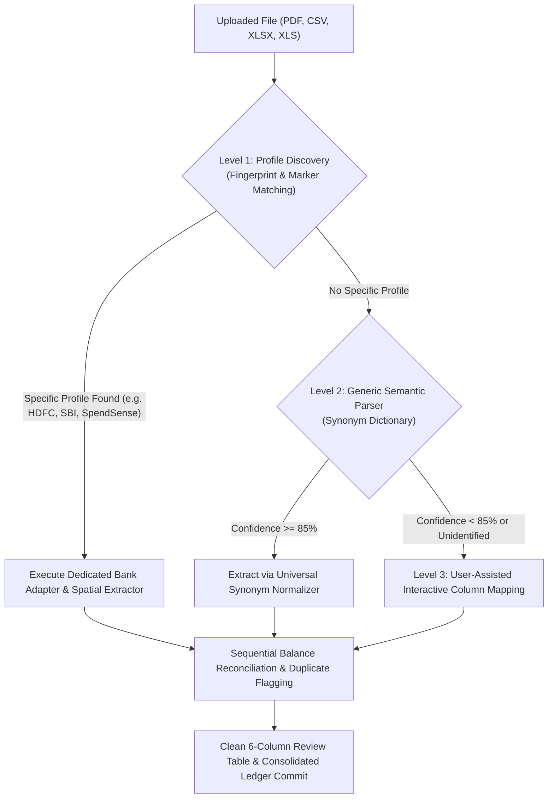

# SpendSense Bank Statement Format Compatibility Matrix

This document provides a comprehensive compatibility, verification, and technical specification reference for SpendSense's Universal Bank Statement Import engine.

---

## 1. Architectural Principles & Import Defense

SpendSense processes bank and card statements entirely **on-device (client-side)** within Web Workers and local WASM environments:

1. **Strict Balance Ingestion Defense**:
   - Opening balances, closing balances, running balances, and statement summary totals (e.g. `Total Withdrawals`, `Total Deposits`, `CLOSING BALANCE CARRIED FORWARD`) are **never imported as transactions**.
   - Balances are parsed strictly to populate the **Statement Balance & Reconciliation Card** and mathematically verify sequential integrity:
     $$\text{Opening Balance} - \sum \text{Withdrawals} + \sum \text{Deposits} = \text{Closing Balance}$$

2. **Accurate Signed Amount & Reversal Interpretation**:
   - In bank deposit/savings accounts:
     - An entry with a negative amount in the **Withdrawal/Debit** column (e.g., `-₹101.86` in HDFC Bank statements representing a POS refund or merchant adjustment) **increases the bank balance**. It is classified as an **Income Reversal** (`type = 'income'`, `classification = 'reversal'`) with positive paise magnitude.
     - Conversely, a negative amount in the **Deposit/Credit** column represents a **Debit Reversal** (`type = 'expense'`, `classification = 'reversal'`).
   - In single signed amount columns:
     - Negative numbers indicate debit/outflow and positive numbers indicate credit/inflow (in asset accounts).
     - Credit card statements use liability conventions (charges increase balance due, payments decrease balance due).

3. **Multi-Line Narration & Reference Preservation**:
   - Secondary narration lines and wrapped transfer descriptions (e.g. `UPI/CR/...`, `RRN...`, `ORDER ID...`) are concatenated into the primary transaction description without requiring repeated dates.
   - Bank reference codes, UTR numbers, and cheque IDs are isolated while ignoring merchant noise prefixes.

4. **Zero-Friction Optional Categorization & Necessity**:
   - Statement import never forces users to select categories or necessity.
   - All transactions default to unclassified (`category_id: null`, `necessity: null`) and can be categorized later via automated rules or ledger review.

5. **Consolidated Personal Ledger Target**:
   - All transactions are committed to the user's unified personal ledger (`account_id: null`, `ingestion_source: 'bank_statement'`). No bank-account management UI or foreign keys are required.

---

## 2. Multi-Level Parsing Architecture

SpendSense operates a 3-tier adaptive parser:

---

## 3. Comprehensive Indian Bank & Format Compatibility Matrix

### Status Legend
- **Verified and tested**: Rigorously validated with real or exact replica bank statement fixtures including multi-line text, signed reversals, and balance reconciliation.
- **Implemented, awaiting real sample**: Implemented with documented bank header patterns and tested with synthetic benchmark fixtures.
- **Generic parser supported**: Automatically handled by the Level 2 semantic synonym dictionary.
- **Requires user-assisted mapping**: Non-standard or unstructured layouts requiring interactive column confirmation.

---

### 3.1 SpendSense Statements & Exports

| Issuer / Source | Product | Formats | Status | Headers Detected | Direction Convention | Known Quirks & Notes |
| :--- | :--- | :--- | :--- | :--- | :--- | :--- |
| **SpendSense** | Consolidated Ledger Export | CSV, PDF, XLSX | **Verified and tested** | `Date`, `Name / Description` / `Transaction Description`, `Type`, `Amount (INR)`, `Payment Method`, `Necessity`, `Category`, `Notes` | Single amount column + Type (`EXPENSE` / `INCOME`) | Round-trip lossless re-import; automatically deduplicated against active ledger. |

---

### 3.2 Tier 1 & Public Sector Banks

| Bank Name | Product | Formats | Status | Date Headers | Description Headers | Debit / Withdrawal Headers | Credit / Deposit Headers | Reference Headers | Balance Headers | Direction Convention | Known Quirks & Notes |
| :--- | :--- | :--- | :--- | :--- | :--- | :--- | :--- | :--- | :--- | :--- | :--- |
| **State Bank of India (SBI)** | Savings & Current Account | PDF, CSV, XLSX, XLS | **Verified and tested** | `Txn Date`, `Transaction Date`, `Value Date` | `Description`, `Narration`, `Particulars` | `Debit`, `Debit Amount`, `Withdrawal` | `Credit`, `Credit Amount`, `Deposit` | `Ref No`, `Cheque No`, `Ref No./Cheque No.`, `UTR` | `Balance`, `Running Balance` | Asset (Dr -, Cr +) | Multi-line UPI narrations require line joining; passbook printouts may have compact space-delimited columns. |
| **Punjab National Bank (PNB)** | Savings & Current Account | PDF, CSV, XLSX, XLS | **Verified and tested** | `Transaction Date`, `Txn Date`, `Date` | `Description`, `Narration`, `Particulars` | `Withdrawals`, `Debit`, `Withdrawal` | `Deposits`, `Credit`, `Deposit` | `Cheque Number`, `Reference No`, `UTR` | `Balance`, `Running Balance` | Asset (Dr -, Cr +) | Headers use plural `Withdrawals` and `Deposits`. |
| **Bank of Baroda (BOB)** | Savings & Current Account | PDF, CSV, XLSX, XLS | **Verified and tested** | `Post Date`, `Transaction Date`, `Date` | `Details`, `Description`, `Narration`, `Particulars` | `Debit`, `Withdrawal`, `Dr` | `Credit`, `Deposit`, `Cr` | `Chq Ref Number`, `Ref Number`, `Reference` | `Balance`, `Available Balance` | Asset (Dr -, Cr +) | Primary transaction date often exported as `Post Date`. |
| **Canara Bank** | Savings & Current Account | PDF, CSV, XLSX, XLS | **Verified and tested** | `Tran Date`, `Transaction Date`, `Date` | `Particulars`, `Description`, `Narration` | `Debit`, `Withdrawal` | `Credit`, `Deposit` | `Cheque No`, `Reference Number`, `Ref No` | `Balance`, `Closing Balance` | Asset (Dr -, Cr +) | NetBanking CSV exports often use `Tran Date` and `Particulars`. |
| **Union Bank of India** | Savings & Current | PDF, CSV, XLSX | **Implemented, awaiting real sample** | `Date`, `Txn Date`, `Tran Date` | `Remarks`, `Narration`, `Transaction Particulars` | `Debit`, `Withdrawal`, `Dr` | `Credit`, `Deposit`, `Cr` | `Ref No`, `Chq No`, `UTR` | `Balance`, `Running Balance` | Asset (Dr -, Cr +) | Remarks frequently embed sender/receiver notes in UPI transactions. |
| **Bank of India (BOI)** | Savings & Current | PDF, CSV, XLSX | **Implemented, awaiting real sample** | `Date`, `Transaction Date` | `Particulars`, `Narration`, `Description` | `Debit`, `Withdrawal`, `Dr` | `Credit`, `Deposit`, `Cr` | `Cheque No`, `Ref No`, `Instrument ID` | `Balance`, `Net Balance` | Asset (Dr -, Cr +) | Instrument ID is frequently utilized as cheque / UTR identifier. |
| **Indian Bank** | Savings & Current | PDF, CSV, XLSX | **Implemented, awaiting real sample** | `Post Date`, `Txn Date`, `Date` | `Description`, `Particulars`, `Narration` | `Debit`, `Dr`, `Withdrawal` | `Credit`, `Cr`, `Deposit` | `Ref Number`, `Chq No`, `UTR` | `Balance`, `Running Balance` | Asset (Dr -, Cr +) | Merged Allahabad Bank accounts preserve legacy branch codes in narrations. |
| **Central Bank of India** | Savings & Current | PDF, CSV, XLSX | **Implemented, awaiting real sample** | `Date`, `Txn Date` | `Particulars`, `Narration` | `Debit Amount`, `Withdrawal`, `Debit` | `Credit Amount`, `Deposit`, `Credit` | `Chq No`, `Ref No` | `Balance`, `Closing Balance` | Asset (Dr -, Cr +) | Passbook prints may group narrations across alternating lines. |
| **Bank of Maharashtra** | Savings & Current | PDF, CSV, XLSX | **Implemented, awaiting real sample** | `Date`, `Transaction Date` | `Particulars`, `Description` | `Debit`, `Dr` | `Credit`, `Cr` | `Cheque No`, `Ref No` | `Balance` | Asset (Dr -, Cr +) | Uses compact Marathi/English bilingual abbreviations in older statements. |
| **UCO Bank** | Savings & Current | PDF, CSV, XLSX | **Implemented, awaiting real sample** | `Date`, `Transaction Date` | `Particulars`, `Narration` | `Debit`, `Dr` | `Credit`, `Cr` | `Chq No`, `Ref No` | `Balance` | Asset (Dr -, Cr +) | Branch numerical transaction codes prefix narration text. |
| **Punjab & Sind Bank** | Savings & Current | PDF, CSV, XLSX | **Implemented, awaiting real sample** | `Date`, `Txn Date` | `Particulars`, `Narration` | `Debit`, `Dr` | `Credit`, `Cr` | `Ref No`, `Chq No` | `Balance` | Asset (Dr -, Cr +) | Fixed-width columnar layouts in legacy ASCII exports. |
| **Indian Overseas Bank (IOB)** | Savings & Current | PDF, CSV, XLSX | **Implemented, awaiting real sample** | `Transaction Date`, `Date` | `Particulars`, `Narration` | `Debit`, `Dr Amount` | `Credit`, `Cr Amount` | `Ref No`, `Chq No` | `Balance` | Asset (Dr -, Cr +) | Teller ID stamps appear in transaction remarks. |

---

### 3.3 Tier 1 & Private Sector Banks

| Bank Name | Product | Formats | Status | Date Headers | Description Headers | Debit / Withdrawal Headers | Credit / Deposit Headers | Reference Headers | Balance Headers | Direction Convention | Known Quirks & Notes |
| :--- | :--- | :--- | :--- | :--- | :--- | :--- | :--- | :--- | :--- | :--- | :--- |
| **HDFC Bank** | Savings & Current Account | PDF, CSV, XLSX, XLS | **Verified and tested** | `Date`, `Transaction Date`, `Txn Date` | `Narration`, `Description`, `Transaction Description` | `Withdrawal Amt.`, `Withdrawal Amount`, `Debit` | `Deposit Amt.`, `Deposit Amount`, `Credit` | `Chq./Ref.No.`, `Chq Ref No`, `Ref No`, `UTR` | `Closing Balance`, `Balance` | Asset (Dr -, Cr +) | **Negative withdrawals** represent refunds/reversals (`-₹101.86` increases balance). Value Date appears on adjacent line or separate column. Multi-page repeats headers. |
| **ICICI Bank** | Savings & Current Account | PDF, CSV, XLSX, XLS | **Verified and tested** | `Transaction Date`, `Value Date`, `Date` | `Transaction Remarks`, `Transaction Details`, `Remarks` | `Withdrawal Amount`, `Withdrawal`, `Dr Amount (INR)` | `Deposit Amount`, `Deposit`, `Cr Amount (INR)` | `Cheque Number`, `Reference Number`, `Ref No` | `Balance (INR)`, `Balance` | Asset (Dr -, Cr +) | Running balance may contain explicit `Cr` or `Dr` suffix indicating sign. |
| **Axis Bank** | Savings & Current Account | PDF, CSV, XLSX, XLS | **Verified and tested** | `Tran Date`, `Transaction Date`, `Date` | `Particulars`, `Description`, `Narration` | `Debit`, `Withdrawal`, `Dr` | `Credit`, `Deposit`, `Cr` | `Chq No`, `Cheque No`, `UTR`, `Ref No` | `Balance`, `Net Balance` | Asset (Dr -, Cr +) | May export short 2-digit years (`DD/MM/YY`). |
| **Kotak Mahindra Bank** | Savings & Current Account | PDF, CSV, XLSX, XLS | **Verified and tested** | `Date`, `Transaction Date` | `Description`, `Narration`, `Transaction Details` | `Withdrawal (Dr)`, `Withdrawal`, `Dr Amount` | `Deposit (Cr)`, `Deposit`, `Cr Amount` | `Chq Ref No`, `Reference No` | `Balance`, `Account Balance` | Asset (Dr -, Cr +) | Headers embed `(Dr)` and `(Cr)` notations. |
| **IDFC FIRST Bank** | Savings & Current Account | PDF, CSV, XLSX, XLS | **Verified and tested** | `Transaction Date`, `Txn Date`, `Date` | `Particulars`, `Description`, `Narration` | `Debit`, `Withdrawal`, `Dr Amount` | `Credit`, `Deposit`, `Cr Amount` | `Cheque Reference Number`, `UTR`, `Ref No` | `Balance`, `Running Balance` | Asset (Dr -, Cr +) | Statements include extensive header metadata blocks before transaction table. |
| **IndusInd Bank** | Savings & Current | PDF, CSV, XLSX | **Implemented, awaiting real sample** | `Date`, `Transaction Date`, `Value Date` | `Description`, `Particulars`, `Narration` | `Debit`, `Withdrawal`, `Dr Amount` | `Credit`, `Deposit`, `Cr Amount` | `Chq Ref No`, `Reference Number`, `UTR` | `Balance`, `Closing Balance` | Asset (Dr -, Cr +) | NetBanking statements include separate Post Date and Value Date columns. |
| **YES Bank** | Savings & Current | PDF, CSV, XLSX | **Implemented, awaiting real sample** | `Txn Date`, `Transaction Date`, `Date` | `Description`, `Narration`, `Particulars` | `Debit`, `Withdrawal`, `Dr` | `Credit`, `Deposit`, `Cr` | `Chq/Ref No`, `Reference No`, `UTR` | `Balance`, `Running Balance` | Asset (Dr -, Cr +) | UPI transactions feature slash-separated RRN identifiers. |
| **Federal Bank** | Savings & Current | PDF, CSV, XLSX | **Implemented, awaiting real sample** | `Tran Date`, `Date`, `Value Date` | `Particulars`, `Description`, `Narration` | `Debit`, `Withdrawal`, `Dr` | `Credit`, `Deposit`, `Cr` | `Cheque No`, `Ref No`, `UTR` | `Balance`, `Available Balance` | Asset (Dr -, Cr +) | FedNet exports merge cheque number and reference code in single column. |
| **RBL Bank** | Savings & Current | PDF, CSV, XLSX | **Implemented, awaiting real sample** | `Date`, `Txn Date` | `Description`, `Narration`, `Transaction Details` | `Debit`, `Withdrawal`, `Dr` | `Credit`, `Deposit`, `Cr` | `Ref No`, `Cheque No`, `UTR` | `Balance`, `Account Balance` | Asset (Dr -, Cr +) | Separate schemas between credit card and retail savings account exports. |
| **AU Small Finance Bank** | Savings & Current | PDF, CSV, XLSX | **Implemented, awaiting real sample** | `Transaction Date`, `Date`, `Value Date` | `Narration`, `Description`, `Particulars` | `Debit`, `Withdrawal`, `Withdrawal Amount` | `Credit`, `Deposit`, `Deposit Amount` | `Reference Number`, `Ref No`, `UTR` | `Balance`, `Closing Balance` | Asset (Dr -, Cr +) | Detailed statement downloads include multi-tier customer summary cards. |
| **Bandhan Bank** | Savings & Current | PDF, CSV, XLSX | **Implemented, awaiting real sample** | `Date`, `Transaction Date` | `Description`, `Particulars`, `Narration` | `Debit`, `Withdrawal` | `Credit`, `Deposit` | `Cheque No`, `Ref No` | `Balance` | Asset (Dr -, Cr +) | Microfinance and retail accounts have distinct layout structures. |
| **South Indian Bank** | Savings & Current | PDF, CSV, XLSX | **Implemented, awaiting real sample** | `Txn Date`, `Date` | `Particulars`, `Narration` | `Debit`, `Withdrawal` | `Credit`, `Deposit` | `Ref No`, `Chq No`, `UTR` | `Balance` | Asset (Dr -, Cr +) | Passbook format often omits UTR codes from printouts. |
| **Karnataka Bank** | Savings & Current | PDF, CSV, XLSX | **Implemented, awaiting real sample** | `Date`, `Transaction Date` | `Particulars`, `Narration` | `Debit`, `Dr` | `Credit`, `Cr` | `Ref No`, `Chq No` | `Balance` | Asset (Dr -, Cr +) | KBL exports frequently format amounts with leading currency symbols. |
| **City Union Bank** | Savings & Current | PDF, CSV, XLSX | **Implemented, awaiting real sample** | `Date`, `Value Date` | `Particulars`, `Narration` | `Debit`, `Dr` | `Credit`, `Cr` | `Cheque No`, `Ref No` | `Balance` | Asset (Dr -, Cr +) | CUB NetBanking statements use compact column layouts. |
| **Saraswat Bank** | Savings & Current | PDF, CSV, XLSX | **Implemented, awaiting real sample** | `Date`, `Txn Date` | `Particulars`, `Narration` | `Debit`, `Withdrawal` | `Credit`, `Deposit` | `Cheque No`, `Ref No` | `Balance` | Asset (Dr -, Cr +) | Co-operative banking statement may omit transaction time stamps. |

---

### 3.4 Credit Cards & Generic Level 2 Fallback

| Adapter ID | Purpose | Formats | Status | Column Synonym Highlights | Balance Direction Convention | Notes |
| :--- | :--- | :--- | :--- | :--- | :--- | :--- |
| **`credit_card_generic`** | Credit Card Statements (HDFC, SBI Card, ICICI, Axis, Amex, OneCard) | PDF, CSV, XLSX | **Verified and tested** | `Date`, `Transaction Details` / `Merchant Name`, `Spends` / `Dr`, `Payment` / `Credits` / `Refund`, `Auth Code` | **Liability** (Purchases increase dues, payments/refunds decrease dues) | Automatically identifies card statement markers (e.g. `Total Amount Due`, `Minimum Amount Due`, `Billing Period`). Handles single amount columns tagged with `CR` or negative signs. |
| **`generic`** | Universal Level 2 Synonym Fallback | PDF, CSV, XLSX | **Verified and tested** | Broad semantic dictionary covering 40+ Indian banking terms | Configurable (Defaults to Asset) | Automatically invoked when specific bank adapter is not recognized. If confidence is below threshold, seamlessly prompts Level 3 interactive mapping. |

---

## 4. Verification & Testing Evidence

All statement import functionality is verified through automated test suites in the SpendSense repository:

1. `tests/statement-bank-fixtures.test.ts`:
   - 14 automated tests covering SBI, HDFC, ICICI, Axis, Kotak, PNB, BOB, Canara, IDFC FIRST, and Credit Card CSV/PDF fixtures.
   - Verified exact paise calculations without IEEE 754 floating point distortion.
   - Verified sequential running balance reconciliation and adversarial duplicate detection.

2. `tests/hdfc-statement-accuracy.test.ts`:
   - 7 rigorous tests validating exact HDFC statement handling.
   - Strict Balance Ingestion Defense: excludes opening and closing balance rows from being imported as transactions.
   - Spatial Table Extractor: bounding-box column alignment prevents column shifts when withdrawal cells are blank.
   - Signed amounts & POS debit reversals: `-₹101.86` in Withdrawal column correctly classified as `type = 'income'`, `classification = 'reversal'`.
   - Optional category & necessity: initializes transactions with `necessity = null` and `category_id = ''`.

3. `tests/spendsense-export-roundtrip.test.ts`:
   - Complete round-trip export and re-import tests verifying lossless round-tripping of CSV exports and automated duplicate recognition against the active ledger.

4. `tests/statement-import-parser.test.ts` & `tests/bank-statement-import-consolidated-ledger.test.ts`:
   - 28 automated tests covering multi-line narration merging, value date preservation, cross-source deduplication (SMS vs manual vs statement), and ephemeral password scrubbing.

5. `tests/date-recovery-statement.test.ts` & `tests/upi-parser.test.ts`:
   - **Date Extraction Resilience:** Tests ordinal dates (`21st Nov 2026`), embedded date prefixes (`Dt: 21/11/2026`), OCR substitutions (`2l/11/2O26`), and compact formats (`21112026`). Verifies that rows with ambiguous dates are preserved in Section D rather than discarded.
   - **UPI Intelligence & Payment Method Disambiguation:** 8 tests validating slash/dash formats (`UPI-FLIPKART`, `UPI/P2M/...`), VPA handle identification, RRN extraction, GST and URL filtering, and acronym-preserving title casing for major Indian banking channels.

6. `tests/historical-statement-reconciliation.test.ts` & `tests/statement-import-redesign.test.ts`:
   - **4-Tier Identity Hierarchy:** Verifies Priority 1 reference matching, Priority 2 SpendSense ID, Priority 3 deterministic source fingerprint, and Priority 4 fuzzy matching with Indian corporate aliases (Bundl Technologies $\leftrightarrow$ Swiggy).
   - **Full-Year Scenario:** Validates that when a user already has January in their ledger with manual edits and uploads a full-year statement, January rows match Section C (Already in Ledger) with 100% confidence, existing ledger edits are completely preserved, and February–November rows appear in Section A (To Review).
   - **4-Section UI Architecture:** Validates row conservation across the four vertical sections (To Review, Imported, Already in Ledger, Skipped & Needs Attention) and state transitions ("Include Anyway", "Skip", "Restore to Review", "Import Selected").
