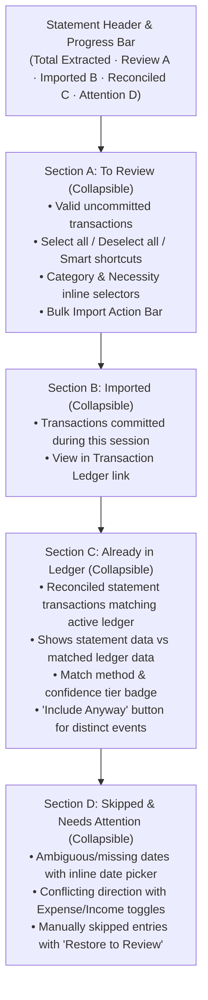
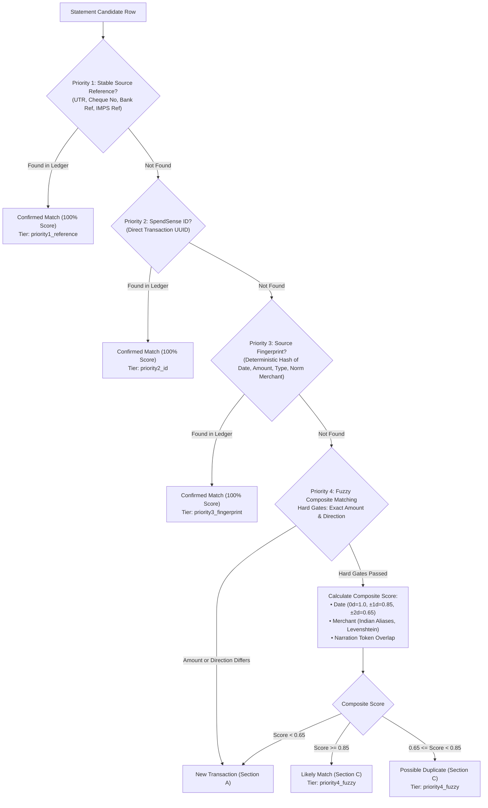

# SpendSense — Universal Bank Statement Import & Reconciliation Implementation Guide

**Date:** November 22, 2026  
**Engineering Domain:** Fintech Software Architecture, PDF/Spatial Parsing, Financial Data Engineering, Transaction Intelligence  
**Author:** SpendSense Engineering Team  

---

## 1. Executive Summary

SpendSense provides Indian personal finance intelligence operating on a **single consolidated personal Ledger**. Every user transaction—whether entered manually via Quick Add, captured automatically via native Android SMS listeners, or imported from electronic bank statements (PDF, CSV, XLSX, XLS)—belongs to one consolidated personal financial history.

This engineering implementation overhauled the Bank Statement Import capability to deliver:

1. **4 Independent Vertical Sections UI Redesign:** Completely removed horizontal tab navigation (`activeSection`). The import review screen now renders four stacked, collapsible cards with independent expand/collapse states and real-time count badges:
   - **Section A — To Review:** Uncommitted, valid transactions awaiting user import. Includes multi-select shortcuts, batch import action bar, category & necessity selectors, and row-level skip actions.
   - **Section B — Imported:** Committed transactions from the current session with direct links to the Transaction Ledger.
   - **Section C — Already in Ledger:** Statement transactions that match existing records in the ledger. Clearly distinguishes Confirmed, Likely, and Possible matches, preserves all user edits, and offers "Include Anyway" recovery.
   - **Section D — Skipped & Needs Attention:** Only entries that genuinely require user attention (missing dates, ambiguous direction, invalid amounts, or manually skipped). Uncategorized transactions are valid financial records and reside in Section A.
2. **Historical Statement Reconciliation (4-Tier Identity Hierarchy):** Solves the realistic problem where a user has January in their ledger with extensive manual edits (custom merchant names, categories, necessity ratings), then uploads a full-year Jan–Nov statement. Reconciles matches without ever overwriting or discarding existing ledger records or user customizations.
3. **Strict 3-Level Necessity Classification:** Strictly enforces three tiers (`essential`, `optional`, `luxury`). `null` is unclassified (missing value), never a fourth level. Corrects everyday discretionary spending (Netflix, Spotify, dining out) to `optional`.
4. **FinRegLab 2025 Compliant Recurring Payment Detection:** Identifies contractual recurring obligations (rent, EMI, insurance, utilities, subscriptions) based on $\ge 3$ transactions, $\ge 2$ intervals, interval CV thresholds ($\le 0.20$ for fixed contracts, $\le 0.35$ for variable utilities), and periodicity confidence $\ge 0.70$. Distinguishes recurring commitments from habitual discretionary spending and decouples recurrence from necessity.
5. **Closing Balance Ingestion Defense:** Preserves mathematical sequential verification while guaranteeing opening, closing, and summary balances are never imported into the ledger.

---

## 2. Review UI Redesign: 4 Independent Vertical Sections

### 2.1 Interface Structure

Instead of hiding rows behind horizontal segmented tabs, the interface renders four vertical sections:

### 2.2 Row Partitioning Invariant

Every extracted row belongs to exactly one section at any given moment:

$$\text{Total Extracted Rows} = N_{\text{Review (A)}} + N_{\text{Imported (B)}} + N_{\text{AlreadyInLedger (C)}} + N_{\text{Attention (D)}}$$

- **`isAttentionRow(r)`**:
  - `r.userSkipped || r.state === 'skipped'`
  - `r.state === 'ambiguous'`
  - `r.classification === 'extraction_problem'`
  - `!r.date || isNaN(Date.parse(r.date))`
  - `!r.amountPaise || r.amountPaise <= 0`
- **`isAlreadyInLedgerRow(r)`**:
  - `!isAttentionRow(r) && !r.includedAnyway && r.state !== 'imported'`
  - `(r.matchedLedger != null || r.classification === 'already_recorded' || r.classification === 'possible_duplicate')`
- **`toReviewRows`**:
  - `r.state !== 'imported' && !isAttentionRow(r) && !isAlreadyInLedgerRow(r)`
- **`importedRows`**:
  - `r.state === 'imported'`

### 2.3 User Action Transitions

1. **"Include Anyway" (in Section C):**
   - Sets `includedAnyway: true, state: 'new', classification: 'new', selected: true`.
   - Transitions immediately from Section C to Section A.
2. **"Skip" (in Section A):**
   - Sets `userSkipped: true, state: 'skipped', selected: false, exclusionReason: 'Permanently skipped by user'`.
   - Transitions immediately from Section A to Section D.
3. **"Restore to Review" (in Section D):**
   - Sets `userSkipped: false, state: 'new', classification: 'new', selected: true, includedAnyway: true`.
   - Transitions immediately from Section D to Section A.
4. **"Confirm Date & Move to Review" (in Section D):**
   - Validates user-entered date, updates `row.date`, clears extraction problem flags, sets `selected: true`.
   - Transitions immediately from Section D to Section A.
5. **"Expense" / "Income" Direction Toggle (in Section D):**
   - Explicitly sets `row.type`, clears ambiguous direction warning, sets `selected: true`.
   - Transitions immediately from Section D to Section A.
6. **"Import Selected" (in Section A):**
   - Commits selected records to the database with `account_id: null`.
   - Sets `state: 'imported', selected: false`.
   - Transitions committed rows from Section A to Section B.

---

## 3. Historical Statement Reconciliation (4-Tier Identity Hierarchy)

When a user imports a full-year statement (e.g. Jan–Nov) having already tracked earlier months (e.g. Jan) in SpendSense:

- Existing ledger records must **never be overwritten or modified**.
- User customizations (custom merchant descriptions, manually assigned categories, custom necessity ratings) must be **completely preserved**.
- Matching statement transactions must be routed to Section C (Already in Ledger) with transparent confidence scores.

### 3.1 The 4-Tier Match Hierarchy

### 3.2 1-to-1 Match Enforcement

To prevent over-matching (where a single ledger entry is matched to multiple statement rows with the same amount), `reconcileStatementWithLedger` tracks `matchedLedgerIds = new Set<string>()`. Once an existing ledger record is claimed by a statement transaction, it cannot be matched to another statement row in the same session.

---

## 4. Strict 3-Level Financial Necessity Classification

SpendSense strictly enforces three discrete levels of financial necessity for personal expense transactions:

1. **`essential`:** Unavoidable obligations for health, shelter, basic sustenance, debt service, and fundamental productivity (rent, utilities, groceries, medicines, diagnostic tests, EMIs, loans, insurance, school fees, fuel/commute).
2. **`optional`:** Discretionary spending that provides enjoyment, entertainment, convenience, or quality of life improvements (dining out, food delivery via Swiggy/Zomato, streaming subscriptions like Netflix/Spotify, hobbies, personal care, fitness memberships, domestic leisure).
3. **`luxury`:** Premium, indulgent, high-end discretionary spending (fine dining, luxury apparel brands like Gucci/Rolex, luxury resorts, jewelry, golf clubs, private yacht charter).
4. **`null`:** Unclassified / missing value (NOT a fourth tier!). Income transactions strictly receive `null`.

### 4.1 Decision Hierarchy (6 Tiers)

1. **Step 1: Explicit User Rule (Confidence 1.0)** — User-created rules in `user-merchant-rules` take immediate absolute precedence over all heuristics.
2. **Step 2: User-Confirmed Previous Classification (Confidence 0.95)** — Past user classifications for the same merchant in ledger history are learned automatically.
3. **Step 3: Highly Reliable Merchant Category Mapping (Confidence 0.85)** — Curated verified patterns (e.g. Apollo Pharmacy $\to$ essential, Swiggy $\to$ optional, Rolex $\to$ luxury).
4. **Step 4: Recurrence-Aware Prediction (Confidence 0.80)** — Contractual recurring signals (rent/EMI $\to$ essential, streaming subscription $\to$ optional).
5. **Step 5: Generic Category Heuristic (Confidence 0.65)** — Broad category default rules.
6. **Step 6: Unclassified (null)** — Awaiting explicit user assignment.

---

## 5. Verification & Automated Test Suites

The implementation is verified by dedicated automated test suites in `frontend/tests/`:

- **`historical-statement-reconciliation.test.ts` (7 tests, all passing):**
  - Priority 1 reference matching (UTR / Cheque / Bank Ref) $\to$ 100% Confirmed Match.
  - Priority 2 SpendSense ID matching $\to$ 100% Confirmed Match.
  - Priority 3 normalized fingerprint matching $\to$ 100% Confirmed Match across user edits.
  - Priority 4 Indian fintech corporate alias resolution (Bundl Technologies $\leftrightarrow$ Swiggy).
  - Priority 4 hard gates on amount and direction.
  - 1-to-1 matching invariant.
  - Full-year reconciliation scenario (Jan in ledger with edits; Jan–Nov statement).
- **`recurring-payment-detection.test.ts` (5 tests, all passing):**
  - FinRegLab 2025 monthly fixed contract recurrence (Rent, Netflix, Insurance).
  - Variable utility recurring bills (BESCOM electricity, water, broadband).
  - Rejection of habitual discretionary spending (coffee, random food delivery).
  - Exclusion of internal transfers and credit card bill payments.
  - FinRegLab minimum data threshold ($\ge 3$ transactions, $\ge 2$ intervals).
- **`necessity-classification.test.ts` (7 tests, all passing):**
  - Strictly 3 tiers with `null` as unclassified.
  - Income transactions strictly receive `null`.
  - Everyday discretionary spending categorized as `optional`, not `luxury`.
  - Genuine luxury indulgences classified as `luxury`.
  - User rule override (Step 1).
  - Ledger history learning (Step 2).
  - Recurrence-aware predictions (Step 4).
- **`statement-import-redesign.test.ts` (4 tests, all passing):**
  - Total row conservation ($\text{Total} = A + B + C + D$).
  - "Include Anyway" action moving row from Section C to Section A.
  - "Skip" action moving row from Section A to Section D.
  - "Import Selected" committing rows from Section A to Section B.
