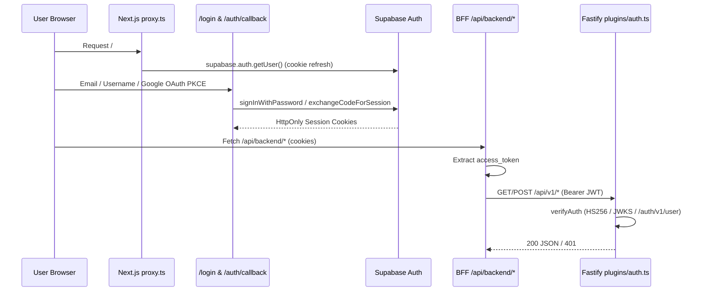
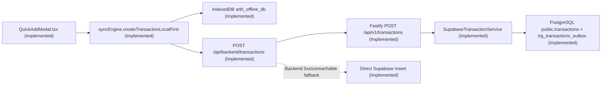
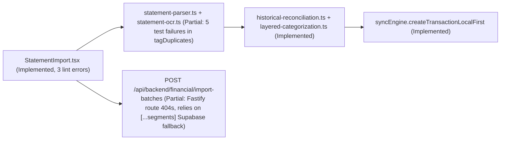
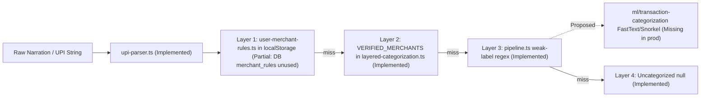
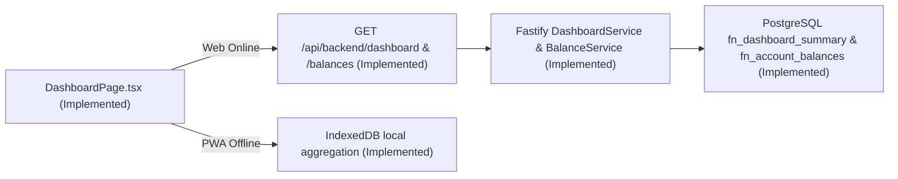
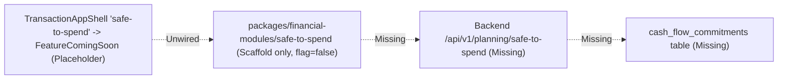
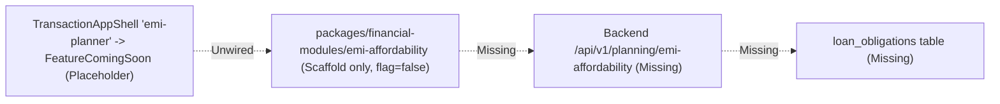
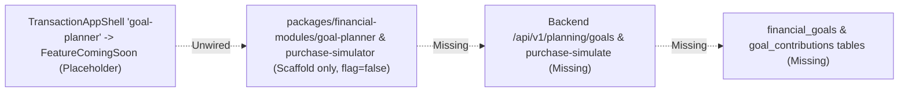
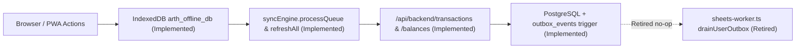

# SpendSense — Complete Repository Audit & Current State Discovery

**Audit Date:** 2026-11-25  
**Repository:** `https://github.com/digitaldodo/Arth.git`  
**Audited Branch / Commit:** `main` @ `518d3c9` (`2026-11-22`, clean working tree)  
**Authoritative Academic Scope:** *SpendSense: Personal Finance Decision Support and EMI Affordability* (Group 369 — Supervisor: Mr. Amit Kumar, Assistant Professor)

---

## 1. Executive Summary

SpendSense (internally originated as **Arth**) is an active, multi-package monorepo containing a **Next.js 16** web/PWA frontend (`@arth/frontend`), a **Fastify 5** backend API (`@arth/backend`), shared TypeScript contracts (`@arth/contracts`), a scaffolded financial-module contract package (`@spendsense/financial-modules`), **39 PostgreSQL/Supabase migrations**, a **native Kotlin + Jetpack Compose Android app** (`android/`), and an **offline Python ML research workspace** (`ml/transaction-categorization/`).

### Key Findings

1. **Core Ledger, Balances, People Tracker, Auth & Statement Import are substantially built**:
   - Email/password, username, and Google OAuth PKCE authentication, WebAuthn App Lock, integer-paise (`BIGINT`) PostgreSQL persistence with Row-Level Security (RLS) across all public tables, IndexedDB offline-first queue (`syncEngine`), Dashboard analytics (`fn_dashboard_summary`), Ledger CRUD/filtering/PDF/CSV/JSON export, People & Settlements (`fn_record_person_settlement`), and multi-format bank statement import (CSV/XLSX/text-PDF/local Tesseract OCR) with 4-tier historical reconciliation are implemented.
2. **Core Synopsis Decision-Support Modules are Placeholder UI + Empty Scaffolds**:
   - **Safe-to-Spend**, **EMI Affordability & Stress Testing**, **Goal-Linked Purchase Simulation** (plus out-of-scope **FIRE Planning** and **Financial Insights**) currently render a static `<FeatureComingSoon />` placeholder in `frontend/src/features/transactions/TransactionAppShell.tsx` and map to disabled (`false`) stubs in `packages/financial-modules/` that return `{ status: 'unavailable', reason: 'feature_disabled' }`.
   - **No database tables exist** for `goals`, `budgets`, `emis`/`loan_obligations`, or `cash_flow_commitments`.
3. **Tax Module is Half-Built and Architecturally Disconnected**:
   - **Document intake** (`DocumentsTaxCentre.tsx` + `backend/src/modules/documents/`) supports local PDF/XLSX/CSV reading, optional local Tesseract OCR, conservative classification, regex field extraction, and verified-field storage in `financial_documents` and `tax_extracted_fields`.
   - **Tax engine** (`backend/src/modules/tax/tax-engine.ts`, `tax-rules.ts`, `tax-deductions.ts`) implements deterministic Old vs. New regime math for `AY2024-25` through `TY2026-27` with passing unit tests.
   - **Critical Gap**: `taxRoutes` (`backend/src/modules/tax/tax.routes.ts`) is **not registered** in `backend/src/app.ts` (so `/api/v1/tax/estimate`, `/api/v1/tax/profiles`, `/api/v1/financial/accounts`, `/api/v1/financial/import-batches`, and `/api/v1/financial/transaction-links` 404 on Fastify, and `tax.routes.ts` also declares duplicate `/api/v1/financial/documents*` handlers that collide with `documentsRoutes`). Furthermore, **zero frontend UI** exists for Old vs. New regime comparison, capital gains (explicitly `unsupported` in `tax-engine.ts`), cross-document discrepancy reconciliation, or the tax readiness checklist (`tax-readiness.ts` is unused by any page).
4. **ML Categorization is Rule-Based in Production, Unbuilt in ML Artifacts**:
   - Production categorization (`pipeline.ts`, `layered-categorization.ts`, `user-merchant-rules.ts`) is deterministic regex/keyword weak-label rules + `localStorage` user rules (the `public.merchant_rules` DB table from migration `0028` is unused).
   - `ml/transaction-categorization/` contains Python research/evaluation scripts and a 60-row synthetic CSV (`benchmark_dataset.csv`). In `categorization-evaluation.json`, only `weak_label_rules` executed (`macro_f1: 0.619`, `weighted_f1: 0.889` on 12 test rows); Snorkel, TF-IDF+XGBoost, SentenceTransformer+XGBoost, FastText, and AnchoredHybrid are all `"status": "not_run"`.
5. **Current Quality Gate Failures**:
   - `pnpm typecheck` passes (4/4 projects), `pnpm test:backend` passes (**235/235**), `financial-modules` scaffold tests pass (**11/11**), ML unit tests pass (**7/7**), **BUT `pnpm test:frontend` fails 5 of 742 tests** (in `statement-import-parser.test.ts` and `statement-ocr.test.ts` due to a `tagDuplicates` regression) and **`pnpm lint` fails with 5 errors and 27 warnings**.

---

## 2. Git & Repository State

| Property | Observed Value |
|---|---|
| Remote (`origin`) | `https://github.com/digitaldodo/Arth.git` |
| Active / Default Branch | `main` (synced with `origin/main`) |
| Other Local Branches | `backup-before-author-fix`, `backup-head-after-two-commits-rewrite`, `backup-head-author-fix-20261026` |
| Current HEAD SHA | `518d3c9` |
| Latest Commit Date | `2026-11-22` (`feat(import): intelligent historical statement reconciliation, 4-section UI redesign, recurring detection & 3-tier necessity`) |
| First Commit Date (repo log) | `2026-10-25` (`112fafa` — `chore: project scaffold and tooling setup (Phase 01E)`) |
| Total Commits on `HEAD` | `135` |
| Contributors (`git shortlog -sn --all`) | `digitaldodo` (104), `Ansh` (34), `Avni` (6) |
| Tags / Releases (Git tags) | None (`git tag -l` empty; GitHub Releases used by Android CI workflow `android-release`) |
| Working Tree State | Clean (`nothing to commit, working tree clean`) |

### Recent Commit History (Last 10)

| SHA | Date | Author | Summary |
|---|---|---|---|
| `518d3c9` | `2026-11-22` | `digitaldodo` | Intelligent historical statement reconciliation, 4-section UI redesign, recurring detection & 3-tier necessity |
| `aa761a0` | `2026-11-22` | `digitaldodo` | Multi-month ledger pagination, infinite scrolling, unconstrained All Time date semantics |
| `20d7f7c` | `2026-11-21` | `digitaldodo` | Ledger 3-state inline expansion and editing |
| `2f4b0f6` | `2026-11-21` | `digitaldodo` | Align balance architecture to consolidated ledger, inline editing, UPI extraction |
| `93ff541` | `2026-11-21` | `digitaldodo` | Statement import 3-section workflow, UPI intelligence, layered categorization |
| `2ce3f9e` | `2026-11-21` | `digitaldodo` | Bank statement ledger persistence, date accuracy, duplicate prevention, batch sync |
| `2ba299e` | `2026-11-21` | `digitaldodo` | Guard parser robustness against undefined/missing fields |
| `dc31b43` | `2026-11-21` | `digitaldodo` | Universal bank compatibility, signed reversal parsing, SpendSense export roundtrip |
| `98d5e95` | `2026-11-21` | `digitaldodo` | Spatial PDF extraction, balance defense, optional categorization |
| `3c2e0b1` | `2026-11-21` | `digitaldodo` | Complete bank statement import for consolidated ledger |

---

## 3. Repository Structure & Directory Inventory

> **Note on Documentation Drift**: `ANTIGRAVITY.md` describes a target single-app layout under `src/`. The actual repository is a `pnpm` monorepo (`pnpm-workspace.yaml`: `frontend`, `backend`, `packages/*`) plus `android/`, `ml/`, `supabase/`, `scripts/`, and `docs/`.

| Path | Role & Actual Contents |
|---|---|
| `frontend/` | `@arth/frontend` — Next.js `16.4.6` App Router application, BFF API proxies (`/api/backend/*`, `/api/native/*`, `/api/app-lock/*`), IndexedDB offline cache (`offline-db.ts`), service worker generator (`scripts/build-sw.cjs`), local PDF/OCR/XLSX processing, and all UI feature modules (`src/features/`). |
| `backend/` | `@arth/backend` — Fastify `5.2.1` TypeScript REST API (`src/app.ts`, `src/server.ts`), JWT verification plugin (`src/plugins/auth.ts`), CORS plugin, and domain modules (`auth`, `health`, `transactions`, `categories`, `people`, `dashboard`, `balances`, `documents`, `tax`). |
| `packages/contracts/` | `@arth/contracts` — Shared DTOs, TypeScript types, and exact BigInt paise money helpers (`parseINRToPaise`, `parseNonNegativeINRToPaise`, `paiseToDecimal`, `formatPaiseToINR`, `resolveDateRangePreset`). |
| `packages/financial-modules/` | `@spendsense/financial-modules` — Scaffolded architecture for 11 team modules (`safe-to-spend`, `purchase-simulator`, `emi-affordability`, `goal-planner`, `fire-planner`, `spending-forecast`, `recurring-payments`, `personalized-categories`, `tax-calculation`, `account-aggregator`, `behavioral-insights`). All flags in `feature-flags.ts` are `false`. |
| `supabase/` | Database infrastructure: `migrations/` (`0001` through `0039`), `seed.sql` (comment reference only), `config.toml`, `templates/` (6 SpendSense HTML email templates), `functions/` (`sheets-sync`, `sheets-reconcile`, `_shared/auth.ts`), and `tests/database_security.test.sql` (pgTAP). |
| `ml/transaction-categorization/` | Offline Python research & evaluation scripts (`pipeline.py`, `weak_supervision.py`, `fasttext_adapter.py`, `anchored_hybrid.py`, `train_fasttext.py`, `train_fasttext_embeddings.py`, `evaluate.py`, `evaluation.py`, `imbalance_experiments.py`, `test_pipeline.py`), `benchmark_dataset.csv` (60 synthetic rows), and `evaluation-results.json`. |
| `android/` | Native Kotlin + Jetpack Compose Android client (`com.digitaldodo.arth`) with Room DB, WorkManager sync, biometric App Lock, notification/SMS parsing (`local` and `directSms` flavors), and `android/installer/` signed APK installer module. |
| `scripts/` | Python brand asset and Supabase email template generators/validators (`generate_spendsense_*.py`, `validate_spendsense_*.py`). |
| `docs/` | 44+ architecture, design, tax-source, ML research, and audit Markdown documents plus `docs/decisions/ADR-001-modular-monorepo.md` and `docs/design-concepts/`. |
| `.github/workflows/` | CI/CD workflows: `android-release.yml` (builds, signs, verifies, and publishes APKs to GitHub Releases) and `supabase-config.yml` (validates `supabase/config.toml`, email templates, and brand assets). |
| Root files | `package.json`, `pnpm-workspace.yaml`, `pnpm-lock.yaml`, `vercel.json`, `render.yaml`, `.env.example`, `categorization-evaluation.json`, `ANTIGRAVITY.md`, `AGENTS.md`, `README.md`, `ANDROID_*.md`, `MANUAL_DEPLOYMENT.md`. |

---

## 4. Technology Stack (Observed)

| Layer | Technology & Version | Evidence |
|---|---|---|
| Package Manager | `pnpm@10.24.0` (workspaces) | `package.json`, `pnpm-workspace.yaml` |
| Frontend Framework | Next.js `16.4.6` (App Router, Turbopack), React `19.3.0` | `frontend/package.json` |
| Styling | Tailwind CSS `^4` (`@tailwindcss/turbopack`) | `frontend/package.json`, `frontend/next.config.ts` |
| Client Document / OCR | `pdfjs-dist ^6.5.438`, `tesseract.js ^7.0.0` (`eng` + `hin`), `xlsx ^0.18.5`, `@pdfsmaller/pdf-encrypt ^1.2.0` | `frontend/package.json`, `DocumentsTaxCentre.tsx`, `StatementImport.tsx` |
| Client PDF Generation | `jspdf ^4.2.1`, `jspdf-autotable ^5.0.9` | `frontend/package.json`, `ledger-pdf-exporter.ts` |
| WebAuthn / App Lock | `@simplewebauthn/browser ^14.0.0`, `@simplewebauthn/server ^14.0.3` | `frontend/package.json`, `app-lock/` |
| Backend Framework | Fastify `^5.2.1`, `@fastify/cors ^10.0.2`, TypeScript `^5.7.3` | `backend/package.json` |
| Auth & JWT | Supabase Auth (`@supabase/ssr ^0.12.7`, `@supabase/supabase-js ^2.118.0`), `jose ^6.2.13` | `frontend/package.json`, `backend/src/plugins/auth.ts` |
| Database | PostgreSQL (Supabase), 39 SQL migrations | `supabase/migrations/0001`–`0039` |
| Offline Storage | Native IndexedDB (`arth_offline_db` v7) + custom Service Worker (`sw.template.js` → `sw.js`) | `frontend/src/lib/offline-db.ts`, `frontend/scripts/build-sw.cjs` |
| Mobile Native | Kotlin `2.0.21`, AGP `8.13.2`, KSP, Jetpack Compose, Room, WorkManager, Retrofit | `android/build.gradle`, `android/app/src/` |
| ML Research | Python `unittest` (stdlib); optional research deps in `requirements-research.txt` (`fasttext-wheel`, `snorkel`, `scikit-learn`, `xgboost`, `sentence-transformers`, `imbalanced-learn`, `numpy`) | `ml/transaction-categorization/` |
| Testing | Node `tsx --test` (`tsx ^4.19.3`), Python `unittest`, Gradle unit tests, pgTAP SQL | `package.json`, `frontend/tests/`, `backend/tests/` |

*(Note: `ANTIGRAVITY.md` lists Zustand, shadcn/ui, Dexie.js, Vitest, and Playwright, none of which appear in `frontend/package.json` or `backend/package.json` today — the codebase uses React state/context, custom Tailwind components, raw IndexedDB, and Node's built-in `node:test` via `tsx`.)*

---

## 5. Frontend Architecture

### 5.1 Routing & Layout
- **App Router Pages** (`frontend/src/app/`):
  - `/` (`page.tsx`): Server Component resolving Supabase user & profile (`fn_recover_user_profile` fallback if username missing); renders `<UnauthenticatedHome />` or `<TransactionAppShell user={...} />`.
  - `/login` (`login/page.tsx`, `AuthForm.tsx`, `actions.ts`): Email/password, username-to-email login, signup, forgot password, and Google OAuth PKCE.
  - `/auth/callback`, `/auth/confirm`, `/auth/logout`, `/auth/native-callback`, `/auth/update-password`: Full web and native auth lifecycle handlers.
  - `/download`, `/offline`, `/privacy`: APK distribution page, offline PWA entry, privacy policy.
- **Session Refresh Proxy**: `frontend/src/proxy.ts` (Next.js 16 Network Boundary Proxy) intercepts requests and calls `supabase.auth.getUser()` to refresh `HttpOnly` cookies.
- **Single-Shell Multi-View Navigation** (`frontend/src/features/transactions/TransactionAppShell.tsx`):
  - Uses client-side `AppView` state (`home`, `ledger`, `people`, `categories`, `documents`, `safe-to-spend`, `emi-planner`, `goal-planner`, `fire-planning`, `insights`, `data-sync`, `more`) with lazy `next/dynamic` imports and `visitedViews` caching so mounted views preserve state.
  - Responsive layout: Desktop header tabs + Planning dropdown (`lg:flex`), mobile/tablet header shortcuts (`Docs`, `Plan`), and mobile bottom bar (`Home`, `Ledger`, `+ Quick Add`, `People`, `More`).
  - Integrates `BackNavigationContext` for Android hardware/gesture back handling, `useAppLock` (WebAuthn biometric gate on standalone mobile PWA), and `PwaRuntimeManager`.

### 5.2 State, Offline & API Client
- **State Management**: Component-local React state + Context (`AuthContext`, `BackNavigationContext`) + `syncEngine` singleton pub/sub (`frontend/src/features/sync/sync-engine.ts`). No Zustand or React Query is installed.
- **Offline Persistence**: `frontend/src/lib/offline-db.ts` (`arth_offline_db` v7) manages 11 IndexedDB object stores (`transactions`, `pending_mutations`, `balances`, `categories`, `dashboard_cache`, `sync_meta`, `people`, `person_details`, `pwa_users`, `pwa_context`, `statement_import_batches`).
- **API Communication**: `frontend/src/lib/api-client/index.ts` calls Next.js BFF proxies under `/api/backend/*`, which extract the cookie session JWT and forward `Authorization: Bearer <token>` to Fastify (`INTERNAL_API_URL` / `NEXT_PUBLIC_API_URL`).
  - **Architectural Dual-Path**: Several BFF routes (`/api/backend/transactions`, `/api/backend/dashboard`, `/api/backend/balances`, `/api/backend/[...segments]`) include **direct Supabase fallbacks** when Fastify is unreachable or returns `5xx` (or for `dashboard` necessity reconciliation).
  - Direct `fetch('/api/backend/financial/...')` calls also appear inside feature components (`DocumentsTaxCentre.tsx`, `QuickAddModal.tsx`, `StatementImport.tsx`, `CrossAccountReconciliation.tsx`, `FinancialMessageCapture.tsx`) bypassing `lib/api-client/index.ts`.

### 5.3 Workflow Audit (Frontend)
- **Registration & Login**: Implemented (`login/page.tsx`, `AuthForm.tsx`, `actions.ts`, `/auth/*`).
- **Dashboard**: Implemented (`DashboardPage.tsx` — online fetches `/api/backend/dashboard` & `/api/backend/balances`; standalone PWA reads IndexedDB and computes summaries locally).
- **Ledger & Manual Entry**: Implemented (`TransactionLedger.tsx` with 3-state inline expand/edit, multi-month pagination, infinite scroll, filters, PDF/CSV/JSON export; `QuickAddModal.tsx` with local category suggestion & correction memory).
- **Bank Statement Upload & Review**: Implemented (`StatementImport.tsx`, `StatementImportModal.tsx`, `statement-parser.ts`, `statement-adapters.ts`, `statement-ocr.ts`, `historical-reconciliation.ts`) — **5 failing unit tests** and **3 React Compiler lint errors** currently exist here.
- **Documents & Tax**: `DocumentsTaxCentre.tsx` handles local document parsing/OCR and field review (`financial_documents`, `tax_extracted_fields`), **but has no tax calculation UI, no capital gains UI, no cross-document discrepancy panel, and no checklist UI**.
- **Planning (`safe-to-spend`, `emi-planner`, `goal-planner`, `fire-planning`, `insights`)**: **Placeholder UI only** (`FeatureComingSoon.tsx`).
- **Settings & Sync**: Implemented (`SettingsView.tsx`, `DataSyncSettings.tsx`, `HeaderSyncIndicator.tsx`, `DataExportCard.tsx`, `AppLockSettings.tsx`, `LanguagePreference.tsx`, `SheetsConnectionCard` retired).

---

## 6. Backend Architecture

`backend/src/app.ts` creates the Fastify instance via `buildApp(...)` with DI overrides for testing, registers `@fastify/cors` and `registerAuth`, and mounts **8 route plugins**:

| Module | Registered in `app.ts`? | Endpoints | Service & DB Access |
|---|---|---|---|
| `health` | Yes | `GET /health` | `health.controller.ts` |
| `auth` | Yes | `GET /api/v1/auth/me` | Decorated `request.user` via `plugins/auth.ts` (`jose` HS256 / JWKS / `/auth/v1/user` cache) |
| `transactions` | Yes | `POST /api/v1/transactions`, `GET /api/v1/transactions`, `PATCH /api/v1/transactions/:id`, `DELETE /api/v1/transactions/:id`, `POST /api/v1/transactions/:id/restore` | `SupabaseTransactionService` (user-scoped Supabase client carrying caller JWT; dynamic fallback for missing extended/provenance columns) |
| `categories` | Yes | `GET/POST /api/v1/categories`, `PATCH /api/v1/categories/:id`, `PATCH /api/v1/categories/:id/archive`, `PUT /api/v1/categories/reorder` | `SupabaseCategoryService` + `fn_reorder_categories` RPC |
| `people` | Yes | `GET/POST /api/v1/people`, `GET/PATCH /api/v1/people/:id`, `PATCH /api/v1/people/:id/archive`, `POST /api/v1/people/:id/records`, `POST /api/v1/people/records/:recordId/settlements` | `SupabasePeopleService` + `fn_record_person_settlement` RPC |
| `dashboard` | Yes | `GET /api/v1/dashboard/summary` | `SupabaseDashboardService` + `fn_dashboard_summary` RPC (+ fallback necessity query) |
| `balances` | Yes | `GET /api/v1/balances`, `POST /api/v1/balances/starting`, `POST /api/v1/balances/transfers`, `POST /api/v1/balances/adjustments`, `GET /api/v1/balances/movements` | `SupabaseBalanceService` + `fn_account_balances` & `fn_configure_starting_balances` RPCs |
| `documents` | Yes | `GET/POST /api/v1/financial/documents`, `DELETE /api/v1/financial/documents/:id`, `GET/POST /api/v1/financial/documents/:id/fields`, `PATCH /api/v1/financial/documents/:documentId/fields/:fieldId` | `SupabaseDocumentsService` (`financial_documents`, `tax_extracted_fields`, storage bucket `arth-private-documents`) |
| **`tax`** | **NO (Unregistered!)** | Defines `/api/v1/tax/estimate`, `/api/v1/tax/profiles`, `/api/v1/financial/accounts`, `/api/v1/financial/transaction-links`, `/api/v1/financial/import-batches`, `/api/v1/financial/import-batches/:id/undo`, AND duplicate `/api/v1/financial/documents*` | `tax.routes.ts` calls `compareTax()` (`tax-engine.ts`), `financial_*` tables, `undo_statement_import_batch`, `confirm_transaction_reconciliation`, `reject_transaction_reconciliation`. **Currently unreachable over HTTP!** |

---

## 7. Database Architecture (Supabase / PostgreSQL)

All **39 migrations** (`0001` through `0039`) reside under `supabase/migrations/`. *(Note: `docs/SUPABASE_AUDIT_REPORT.md` records production synchronization through `0036`; migrations `0037`–`0039` were added afterward, and live remote DB access was not available during this audit to verify whether `0037`–`0039` are pushed.)*

### 7.1 Tables Observed Across Migrations `0001`–`0039`

| Domain | Tables | Key Relationships, Constraints & Triggers |
|---|---|---|
| Identity & Security | `public.profiles`, `public.app_lock_credentials`, `public.app_lock_challenges` | `profiles.id` → `auth.users(id)`; `fn_handle_new_user` trigger seeds default categories + generates unique username; WebAuthn tables (`0022`) deny browser access (`service_role` only). |
| Core Ledger | `public.categories`, `public.transactions`, `public.outbox_events` | `transactions.amount_paise BIGINT > 0`; `category_id` nullable since `0037`; `necessity` nullable for expenses and strictly `NULL` for income; composite FK `(category_id, user_id, type)` → `categories`; `account_id` / `import_batch_id` FKs (`0028`); provenance columns (`0035`, `0036`); `trg_transactions_outbox` writes to `outbox_events`; `trg_validate_transaction_balance` (`0025`/`0039`) prevents negative configured Cash/Online balances. |
| Balances & Transfers | `public.balance_movements` | Tracks `transfer` (`cash` ↔ `online`/`upi`) and auditable `adjustment`; `trg_validate_movement_balance` enforces balance invariants. |
| Statement Import & Reconciliation | `public.financial_accounts`, `public.statement_import_batches`, `public.statement_import_batch_items`, `public.account_movements`, `public.transaction_links` | `statement_import_batch_items` snapshotted via `trg_snapshot_statement_import_item` for atomic `undo_statement_import_batch` (`0030`); `confirm_transaction_reconciliation` & `reject_transaction_reconciliation` (`0031`) prevent double-counting transfers/card settlements in `fn_dashboard_summary`. |
| Categorization Rules | `public.merchant_rules` (`0028`) | Composite FK `(category_id, user_id, transaction_type)` → `categories`. **Currently unused by backend/frontend** (rules live in browser `localStorage`). |
| Tax & Documents | `public.financial_documents`, `public.tax_extracted_fields`, `public.tax_profiles` (`0028`) | `tax_extracted_fields` composite FK `(document_id, user_id)` → `financial_documents` (`ON DELETE CASCADE`); retention invariant enforces `metadata_only` (`storage_path IS NULL`) or `retain_until` in private bucket `arth-private-documents`. |
| People & Obligations | `public.people`, `public.person_money_records`, `public.person_money_settlements` (`0009`–`0011`) | Atomic `fn_record_person_settlement` with `FOR UPDATE` row lock; `ON DELETE CASCADE` / restricted deletion history protection. |
| Sync & Cron Infra | `public.user_sheet_connections` (`0017`), `public.cron_job_runs`, `public.app_cron_config` (`0020`) | Legacy Sheets sync + `pg_cron` scheduling; Sheets worker is retired (`drainUserOutbox` is a no-op). |
| **Missing Synopsis Tables** | **None exist for:** `goals`, `goal_contributions`, `cash_flow_commitments` / `recurring_obligations`, `loan_obligations` / `emis`, `budgets` | Confirmed absent across all 39 migration files. |

### 7.2 Key PostgreSQL Functions (RPCs)
- `fn_dashboard_summary(p_start_date, p_end_date)` (`0012`, `0021`, `0027`, `0031`, `0037`) — `SECURITY INVOKER`, excludes confirmed `transfer_pair`/`card_settlement` links, aggregates income/expense/category/necessity (including uncategorized `LEFT JOIN`).
- `fn_account_balances()` (`0018`, `0024`, `0025`, `0026`, `0032`, `0038`, `0039`) & `fn_configure_starting_balances()` (`0023`, `0025`) — consolidated Cash + Online/UPI balance engine.
- `fn_financial_account_balances()` (`0032`) — per-`financial_accounts` balance aggregation.
- `fn_reorder_categories()`, `fn_record_person_settlement()`, `undo_statement_import_batch()`, `confirm_transaction_reconciliation()`, `reject_transaction_reconciliation()`.
- Username/Auth helpers: `fn_handle_new_user()`, `fn_get_email_by_username()`, `fn_check_username_available()`, `fn_set_own_username()`, `fn_recover_user_profile()`, `fn_delete_own_account()`.

---

## 8. Data-Flow Diagrams (Implemented vs. Partial vs. Missing)

### 8.1 Authentication & Session Flow (`Implemented`)

### 8.2 Manual Transaction Creation (`Implemented`)

### 8.3 Bank Statement Import (`Partially implemented — 5 failing tests & unwired batch route`)

### 8.4 Transaction Categorization (`Partial — Rule baseline only; ML models not integrated`)

### 8.5 Dashboard Calculations (`Implemented`)

### 8.6 Safe-to-Spend Calculation (`Placeholder / Scaffold only`)

### 8.7 EMI Affordability & Stress Testing (`Placeholder / Scaffold only`)

### 8.8 Goal-Linked Purchase Simulation (`Placeholder / Scaffold only`)

### 8.9 Tax Document Extraction, Verification & Calculation (`Partially implemented / Disconnected`)

```mermaid
flowchart LR
    DTC["DocumentsTaxCentre.tsx (Implemented for intake/review)"] --> PDF["Browser pdfjs-dist / tesseract.js / xlsx (Implemented)"]
    PDF --> EXT["document-classifier.ts + document-extractor.ts (Partial: generic patterns, no CapGains adapter)"]
    EXT --> DOC_API["POST /api/backend/financial/documents & /fields -> documentsRoutes (Implemented)"]
    DOC_API --> PG_DOC["financial_documents + tax_extracted_fields (Implemented)"]
    PG_DOC -.->|Unwired| REV["tax-document-review.ts & tax-readiness.ts (Implemented, unused in UI)"]
    REV -.->|Missing UI| TAX_API["POST /api/v1/tax/estimate & /profiles in tax.routes.ts (Unregistered in app.ts)"]
    TAX_API --> ENG["tax-engine.ts + tax-rules.ts (Implemented for salary/deductions; Capital Gains Missing)"]
```

### 8.10 Data Synchronization (`Implemented for Offline↔PG; Retired for Google Sheets`)

---

## 9. Feature-by-Feature Audit & Source Evidence

Status taxonomy: **Implemented and verified** | **Implemented, not verified** | **Partially implemented** | **Scaffold only** | **Placeholder** | **Missing** | **Blocked**

### 9.1 Synopsis Scope Features

| Feature Area | Sub-feature | Status | Source Evidence | Missing / Bugs |
|---|---|---|---|---|
| **A. Transaction Management** | Manual entry, edit, soft-delete, restore, categories, necessity, filters, pagination, PDF/CSV/JSON export | **Implemented and verified** (with 2 unused-var lint warnings in `TransactionLedger.tsx`) | `QuickAddModal.tsx`, `TransactionLedger.tsx`, `CategoryManager.tsx`, `transaction.routes.ts`, `transaction.service.ts`, `category.routes.ts`, `migrations/0002,0003,0008,0037` | None blocking core CRUD; `accounts` dropdown in `QuickAddModal` fails silently because `/api/v1/financial/accounts` is unregistered in Fastify. |
| **A. Structured Statement Import** | CSV, XLSX/XLS, text PDF, encrypted PDF, local OCR, column mapping, import history, undo | **Partially implemented** | `StatementImport.tsx`, `statement-parser.ts`, `statement-adapters.ts`, `statement-ocr.ts`, `historical-reconciliation.ts`, `migrations/0028,0030,0033` | **5 failing tests** (`statement-import-parser.test.ts`: 4, `statement-ocr.test.ts`: 1); **3 React Compiler lint errors** in `StatementImport.tsx`; `financial/import-batches` & `transaction-links` routes in `tax.routes.ts` unregistered in `app.ts`. |
| **A. ML Categorization** | Regex/heuristic rules + UPI parser + `localStorage` rules | **Implemented, not verified** (rules) / **Scaffold only** (ML) | `frontend/src/features/categorization/*`, `ml/transaction-categorization/*`, `categorization-evaluation.json` | No trained FastText/Snorkel/XGBoost model; `ml` models `"status": "not_run"`; `public.merchant_rules` DB table unused; `upi-parser.ts` has 2 lint errors (`prefer-const`). |
| **B. Safe-to-Spend** | Available balance, expected income, unpaid bills, essentials, EMIs, savings, cash buffer, double-count guard, explanation | **Placeholder** (UI) / **Scaffold only** (Domain) | `TransactionAppShell.tsx` (`FeatureComingSoon`), `packages/financial-modules/src/modules/safe-to-spend/` & `spending-forecast/` | Entire deterministic engine, DB tables (`cash_flow_commitments`), API endpoints, double-counting guard, and interactive UI missing. |
| **C. EMI Affordability** | Principal, rate, tenure, EMI, repayment, existing EMIs, baseline vs. stress scenarios, explanation | **Placeholder** (UI) / **Scaffold only** (Domain) | `TransactionAppShell.tsx` (`FeatureComingSoon`), `packages/financial-modules/src/modules/emi-affordability/` | Entire reducing-balance math, stress-testing engine, DB table (`loan_obligations`), API endpoints, and interactive UI missing. |
| **D. Goal-Linked Purchase Simulator** | Goal CRUD, target date, contributions, purchase impact, delay recalculation, scenario comparison | **Placeholder** (UI) / **Scaffold only** (Domain) | `TransactionAppShell.tsx` (`FeatureComingSoon`), `packages/financial-modules/src/modules/goal-planner/` & `purchase-simulator/` | Entire domain logic, DB tables (`financial_goals`, `goal_contributions`), API endpoints, and interactive UI missing. |
| **E. Tax: Document Intake & Local OCR** | PDF text extraction, local Tesseract OCR, CSV/XLSX intake, classifier, field candidate extraction, user review/verify | **Implemented and verified** | `DocumentsTaxCentre.tsx`, `document-classifier.ts`, `document-extractor.ts`, `documents.routes.ts`, `documents.service.ts`, `migrations/0028` | `detectTaxFieldCandidates` does not filter by `documentKind` adapter; missing dedicated `capital_gains`, `investment_statement`, `fd_interest` adapters. |
| **E. Tax: Old vs. New Regime Engine** | Versioned rulesets (`AY2024-25`..`TY2026-27`), slabs, 87A rebate + marginal relief, surcharge, cess, deductions (`80C/123`, `80D/126`, `80CCD`, `24b`, `80E`), break-even | **Partially implemented** | `backend/src/modules/tax/tax-engine.ts`, `tax-rules.ts`, `tax-deductions.ts`, `tax.routes.ts`, `tax-engine.test.ts`, `official-tax-calculator.test.ts` | **`taxRoutes` not registered in `backend/src/app.ts`**; **zero frontend UI** for regime comparison or `tax_profiles`; `tax.routes.ts` collides with `documentsRoutes`. |
| **E. Tax: Verification, Reconciliation, Cap Gains & Checklist** | Cross-doc discrepancy flagging, capital gains estimation, tax summary, deduction/readiness checklist | **Partially implemented** / **Missing** (Cap Gains & UI) | `tax-document-review.ts`, `tax-readiness.ts`, `ledger-tax-reconciliation.ts` | `tax-engine.ts` returns `'unsupported'` for `specialRateIncomeRupees > 0n` (Capital Gains **Missing**); `tax-readiness.ts` & `tax-document-review.ts` are **not wired** into `DocumentsTaxCentre.tsx`; cross-document reconciliation UI/API missing. |

### 9.2 Additional / Out-of-Scope Modules Audited Separately

| Module | Status | Synopsis Scope? | Source Evidence |
|---|---|---|---|
| **People & Money Tracker** | **Implemented and verified** | Extension (not in synopsis) | `PeoplePage.tsx`, `people.routes.ts`, `people.service.ts`, `migrations/0009`–`0011` |
| **Native Android App + SMS/Notification Capture + Installer** | **Implemented, not device-verified** | Explicit exclusion / Extension | `android/app/`, `android/installer/`, `.github/workflows/android-release.yml` (cannot run Gradle/physical device check in current workspace) |
| **WebAuthn Biometric App Lock (PWA)** | **Implemented and verified** | Extension | `frontend/src/features/app-lock/`, `/api/app-lock/*`, `migrations/0022` |
| **Google Sheets Dual-Write Sync** | **Retired / Disabled** | Extension | `sheets-worker.ts`, `supabase/functions/sheets-*` (`drainUserOutbox` is a no-op) |
| **FIRE Planning** | **Placeholder / Scaffold only** | Out of scope | `TransactionAppShell.tsx`, `packages/financial-modules/src/modules/fire-planner/` |
| **Account Aggregator** | **Scaffold only** | Explicit exclusion | `packages/financial-modules/src/modules/account-aggregator/` |
| **Behavioral Insights & Personalized Categories & Spending Forecast & Recurring Payments (package)** | **Scaffold only** (`recurring-detector.ts` exists only inside `frontend/src/features/categorization/`) | Extension (`spending-forecast` & `recurring` support Safe-to-Spend) | `packages/financial-modules/src/modules/{behavioral-insights,personalized-categories,spending-forecast,recurring-payments}/` |

---

## 10. Verified Test & Tooling Execution Results

Executed directly during this audit on `2026-11-25`:

| Check | Command | Result | Details |
|---|---|---|---|
| Workspace Typecheck | `pnpm typecheck` | **PASS** (4/4 projects) | `@arth/contracts`, `@arth/backend`, `@arth/frontend` zero TS errors |
| Backend Tests | `pnpm test:backend` | **PASS** (235/235, 0 fail) | Auth, balances, categories, dashboard, documents, money, people, tax-engine, official-tax-calculator, transactions, schema audit |
| Frontend Tests | `pnpm test:frontend` | **FAIL** (737 pass, **5 fail** / 742) | Failures in `tests/statement-import-parser.test.ts` (tests 129, 130, 131, 132) and `tests/statement-ocr.test.ts` (test 166) |
| Financial Modules Tests | `npx tsx --test packages/financial-modules/src/modules/*/tests/*.test.ts` | **PASS** (11/11, 0 fail) | All 11 modules assert `status === 'unavailable'` when disabled |
| ML Python Tests | `python -m unittest discover -s ml/transaction-categorization -p "test_*.py" -v` | **PASS** (7/7, 0 fail) | Covers normalization, abstention, metrics, temporal split |
| Frontend Lint | `pnpm lint` | **FAIL** (5 errors, 27 warnings) | `upi-parser.ts` (2 `prefer-const`), `StatementImport.tsx` (3 `react-hooks/preserve-manual-memoization`) |
| Live Supabase / Android / E2E | N/A | **Not Executed** | No Supabase service credentials in workspace; no Android emulator/device or Gradle verification run |

---

## 11. Known Architectural Problems & Technical Debt

| ID | Issue | Severity | Affected Modules & Files | Integration Risk | Recommended Resolution |
|---|---|---|---|---|---|
| **PROB-01** | `taxRoutes` not registered in `app.ts` & collides with `documentsRoutes` | **Critical** | `backend/src/app.ts`, `backend/src/modules/tax/tax.routes.ts`, `backend/src/modules/documents/documents.routes.ts` | Registering `taxRoutes` crashes Fastify on duplicate `/api/v1/financial/documents*` routes; currently `/api/v1/tax/*` & `/api/v1/financial/accounts|import-batches|transaction-links` return 404. | Split `tax.routes.ts` so `tax` owns `/api/v1/tax/*` only; move `accounts`/`import-batches`/`transaction-links` to Module A (`financial-imports`); register both in `app.ts`. |
| **PROB-02** | `tagDuplicates()` regression breaking 5 frontend tests | **High** | `frontend/src/features/imports/statement-parser.ts`, `historical-reconciliation.ts`, `statement-ocr.ts` | Overwrites `ambiguous`/`needs_review` states with `possible_duplicate`, ignores `accountId`, and matches conflicting `statement_reference` rows via Tier 3/4 fallback. | Preserve primary review/OCR states, enforce `accountId` scoping, and treat conflicting non-empty references as distinct transactions. |
| **PROB-03** | BFF routes duplicate Supabase writes & bypass Fastify validation | **High** | `frontend/src/app/api/backend/transactions/route.ts`, `[...segments]/route.ts`, `dashboard/route.ts` | Fallback directly hits Supabase with differing payload shapes (`amount_paise` vs `amount`, missing full Zod/validation checks). | Standardize on Fastify as primary domain boundary and align fallback contracts or disable silent divergence in dev. |
| **PROB-04** | `merchant_rules` DB table unused; rules trapped in `localStorage` | **Medium** | `supabase/migrations/0028`, `frontend/src/features/categorization/user-merchant-rules.ts`, `pipeline.ts` | Learned merchant rules do not sync between web browsers, PWA, and Android. | Expose `/api/v1/financial/merchant-rules` in Module A and sync `localStorage`/IndexedDB with `public.merchant_rules`. |
| **PROB-05** | `StatementImport.tsx` & `TransactionLedger.tsx` monoliths | **Medium** | `StatementImport.tsx` (2,815 lines), `TransactionLedger.tsx` (1,907 lines), `TransactionAppShell.tsx` (992 lines) | High merge-conflict hotspot if multiple developers touch import/ledger/shell simultaneously; React Compiler lint errors in `StatementImport.tsx`. | Lock `TransactionAppShell.tsx` to single-line view swaps; keep new planning modules in separate feature directories. |
| **PROB-06** | Unwired tax helpers & missing Capital Gains rules | **Medium** | `frontend/src/features/tax/{tax-readiness,tax-document-review,ledger-tax-reconciliation}.ts`, `backend/src/modules/tax/tax-engine.ts` | Tax center appears complete in code tree (`tax/`), masking that calculator UI, checklist UI, and Capital Gains math are unintegrated/missing. | Wire existing helpers into `DocumentsTaxCentre` sub-tabs and implement deterministic STCG/LTCG rules in `tax-engine.ts`. |
| **PROB-07** | ML pipeline disconnected from backend & unmeasured | **Medium** | `ml/transaction-categorization/`, `categorization-evaluation.json`, `packages/financial-modules/src/modules/personalized-categories/` | Academic synopsis ML milestone lacks trained artifact, macro-F1 benchmark on realistic corpus, and runtime inference path. | Build offline training/eval pipeline + deployable lightweight model/scorer behind `/api/v1/categorization/suggest`. |
| **PROB-08** | Documentation drift (`ANTIGRAVITY.md` vs monorepo; `SUPABASE_AUDIT_REPORT.md` stops at `0036`) | **Low** | `ANTIGRAVITY.md`, `docs/SUPABASE_AUDIT_REPORT.md` | New team members may look for non-existent `src/` root or assume only 36 migrations exist. | Document actual `frontend/`/`backend/`/`packages/` layout and note migrations `0037`–`0039`. |
