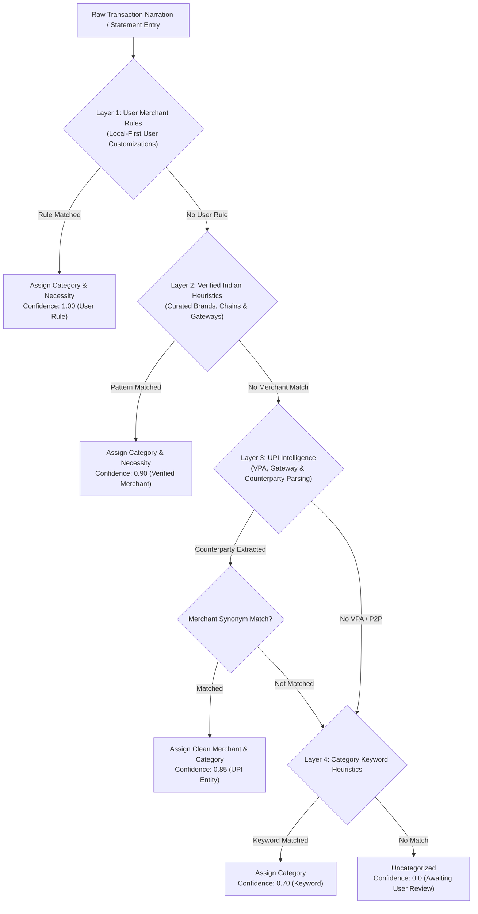

# SpendSense — Layered Transaction Categorization & Machine Learning Architecture

**Date:** November 22, 2026  
**Engineering Domain:** Financial NLP, Weak Supervision, Deterministic Rules, Behavioral Machine Learning  
**Reference Modules:** `layered-categorization.ts`, `necessity-classifier.ts`, `user-merchant-rules.ts`, `upi-parser.ts`, `recurring-detector.ts`  

---

## 1. Executive Summary

SpendSense categorizes Indian financial transactions with high accuracy, explainability, and immediate user personalization. The engine combines deterministic rules, merchant normalization, UPI narration intelligence, weak supervision (Snorkel), text embeddings (FastText), and local user rules into a cohesive layered pipeline.

Core tenets of the categorization architecture:
1. **Explainable Prediction:** Every categorization output carries an explicit `confidence` score (0.0 to 1.0) and an audible `reason` explaining which layer or rule generated the classification.
2. **User Primacy (Layer 1):** User-defined rules take immediate, absolute effect without requiring model retraining.
3. **Strict 3-Tier Necessity:** Separates Category from Financial Necessity, enforcing strictly 3 tiers (`essential`, `optional`, `luxury`). `null` is unclassified, not a fourth tier.
4. **Offline Resilience:** All rules, regexes, and user customizations operate fully on-device within volatile memory and IndexedDB/LocalStorage.

---

## 2. Multi-Layer Categorization Architecture

### Layer 1: User-Specific Merchant Rules (`user-merchant-rules.ts`)
- **Confidence:** `1.00`
- **Behavior:** When a user manually changes a transaction's category or necessity, SpendSense prompts them to remember this choice for future transactions from this merchant.
- **Persistence:** Stored in client-side storage (`spendsense_merchant_rules_v1:{userId}`) and takes instant effect in the next turn of imports or ledger processing.

### Layer 2: Verified Indian Merchant Heuristics (`layered-categorization.ts`)
- **Confidence:** `0.90`
- **Coverage:** Curated regex dictionary covering over 150 top Indian merchants, delivery apps, supermarkets, utilities, transport networks, diagnostic chains, and streaming platforms.
- **Discretionary vs Luxury Correction:** Everyday dining (Swiggy, Zomato, Starbucks) and streaming entertainment (Netflix, Spotify) map to `optional`. True luxury brands (Gucci, Rolex, Taj Hotels) map to `luxury`.

### Layer 3: UPI Intelligence & Counterparty Extraction (`upi-parser.ts`)
- **Confidence:** `0.85`
- **Capability:** Parses complex Indian banking narrations (e.g. `UPI/632145897120/PAY TO SWIGGY/swiggy@icici/UPI DR`) to isolate:
  - Clean counterparty merchant name (`Swiggy`)
  - UPI Reference / RRN (`632145897120`)
  - Payment channel (`upi`)
  - Direction (`debit` / expense)

### Layer 4: Fallback & Safe Default
- **Confidence:** `0.00`
- **Behavior:** If no heuristic matches, the transaction safely defaults to `Uncategorized` (`category_id: ''`, `necessity: null`). SpendSense **never throws runtime exceptions** on unknown inputs and never invents arbitrary categories.

---

## 3. Dedicated 6-Step Necessity Classifier (`necessity-classifier.ts`)

Necessity classification operates on an independent 6-tier hierarchy:

$$\text{User Rule} \succ \text{Ledger History} \succ \text{Verified Merchant} \succ \text{Recurring Signal} \succ \text{Category Heuristic} \succ \text{Unclassified}$$

1. **Step 1: User-Defined Rule ($\kappa = 1.00$):** Explicit user mapping for this counterparty.
2. **Step 2: User-Confirmed Previous Classification ($\kappa = 0.95$):** Historical ledger transactions with confirmed user ratings.
3. **Step 3: Verified Merchant Pattern ($\kappa = 0.85$):** Curated mapping (e.g. Apollo Pharmacy $\to$ `essential`, Starbucks $\to$ `optional`, Rolex $\to$ `luxury`).
4. **Step 4: Recurrence-Aware Prediction ($\kappa = 0.80$):** Signals from `recurring-detector.ts` (Rent/EMI $\to$ `essential`, Streaming $\to$ `optional`).
5. **Step 5: Category Default Heuristic ($\kappa = 0.65$):** Standard category associations (Groceries $\to$ `essential`, Entertainment $\to$ `optional`).
6. **Step 6: Unclassified Fallback ($\kappa = 0.00$):** Returns `necessity: null` for user manual assignment.

Income transactions are strictly excluded and always return `necessity: null`.
